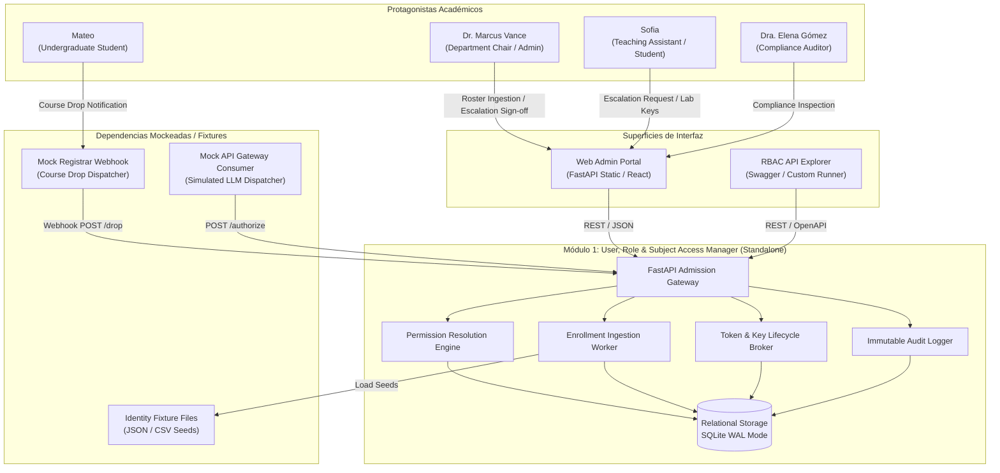

v2 — 2026-10-14 (Solu-2)

# ARCHITECTURE.md — Arquitectura Técnica e Invariantes
## Módulo 1: User, Role, and Subject Access Manager (Tier: Foundation)

---

## 1. Resumen Ejecutivo y Decisiones Tecnológicas Base

El **Módulo 1 (User, Role, and Subject Access Manager)** proporciona la infraestructura fundamental de identidad, autorización contextual por asignatura (*Subject-Scoped RBAC/ABAC*), emisión de credenciales y auditoría criptográfica inmutable para la flota de cómputo IA de la Universidad (31 workstations de 24 GB VRAM y 1 servidor central de 96 GB VRAM).

### 1.1 Principios de Arquitectura (Boring Technology & Pragmatism)
Siguiendo la filosofía pragmática de la arquitectura de software:
1. **Tecnología Aburrida y Predecible (Boring Technology):** Para el cimiento de seguridad, la estabilidad operativa prima sobre la novedad. Se adopta **FastAPI (Python 3.11+)** con **Pydantic v2** y **SQLAlchemy 2.0** sobre **SQLite en modo WAL (Write-Ahead Logging)** con soporte transaccional ACID estricto. Esto garantiza cero dependencias de red externas, inicio en frío en menos de 2.0 segundos y una huella de memoria inferior a 120 MB en reposo.
2. **Ejecutabilidad 100% Standalone:** El módulo corre de forma totalmente autónoma en un único contenedor Docker Compose. No requiere conexión activa a Kubernetes, Active Directory real ni a los otros 11 módulos del clúster; opera con *Mock Identity Fixtures* precargados y simula las respuestas de hardware y vLLM.
3. **Aislamiento Criptográfico y Cero Secretos en Memoria Secundaria:** Las llaves de API se generan con entropía criptográfica (`os.urandom(32)`), se prefijan para inspección (`uai_live_...`) y se almacenan exclusivamente como hashes SHA-256 con salt único de 16 bytes.

---

## 2. Topología de Componentes y Límites de API

El subsistema se estructura internamente en cuatro componentes desacoplados gobernados por contratos de interfaz definidos:

```
+====================================================================================================+
|                               MÓDULO 1: BOUNDARY DE CONTENEDOR (DOCKER)                            |
|                                                                                                    |
|   +--------------------------------------------------------------------------------------------+   |
|   |                         FASTAPI HTTP ROUTER & ADMISSION GATEWAY                            |   |
|   |   - Security Middleware (Bearer Token & API Key Authentication)                            |   |
|   |   - Context Extractor ('X-Academic-Subject-Context' validation)                            |   |
|   |   - RFC-7807 Exception Handler (Structured Error Payloads)                                 |   |
|   +--------------------------------------------------------------------------------------------+   |
|                 |                                   |                              |               |
|                 v                                   v                              v               |
|   +---------------------------+   +----------------------------------+   +---------------------+   |
|   | PERMISSION RESOLUTION     |   | ENROLLMENT INGESTION WORKER      |   | TOKEN LIFECYCLE     |   |
|   | ENGINE (RBAC / ABAC)      |   | (Batch Transaction Pipeline)     |   | BROKER              |   |
|   |                           |   |                                  |   |                     |   |
|   | - Context Isolation Evaluator| - CSV / JSON Stream Validator    |   | - Key Generator     |   |
|   | - Confused Deputy Guard   |   | - Quarantine Generator           |   | - SHA-256 Hasher    |   |
|   | - Rule Engine & Explainers|   | - Atomic DB Ingestion (< 3s)     |   | - Revocation Cache  |   |
|   +---------------------------+   +----------------------------------+   +---------------------+   |
|                 |                                   |                              |               |
|                 +-----------------+                 |                 +------------+               |
|                                   v                 v                 v                            |
|                       +------------------------------------------------------------+               |
|                       |            IMMUTABLE AUDIT LOGGER (LEDGER CORE)            |               |
|                       | - SHA-256 Hash Chaining (H_n = SHA256(H_n-1 || Payload_n)) |               |
|                       | - Sanitization Pipe (Zero Token Leakage Enforcer)          |               |
|                       | - Fast B-Tree Indexed Query Store (< 200ms p95)            |               |
|                       +------------------------------------------------------------+               |
|                                                     |                                              |
|                                                     v                                              |
|                       +------------------------------------------------------------+               |
|                       |       RELATIONAL PERSISTENCE (SQLite WAL / PostgreSQL)     |               |
|                       | identities · subjects · memberships · roles · audit_ledger |               |
|                       +------------------------------------------------------------+               |
+====================================================================================================+
```

### 2.1 Especificación de los Cuatro Componentes Internos

#### 1. Permission Resolution Engine (Motor RBAC/ABAC)
- **Responsabilidad:** Evaluar solicitudes de autorización en tiempo real con latencia determinista ($p95 < 20\text{ ms}$).
- **Entrada:** Tupla `(identity_id, subject_context, resource_arn, action)`.
- **Lógica de Ejecución:**
  1. Verifica que la identidad posea una membresía en estado `ACTIVE` en `subject_context`.
  2. Ejecuta la regla `Resource-Subject Binding`: valida que el prefijo del `resource_arn` coincida exactamente con `subject_context`.
  3. Consulta la existencia de una escalación temporal activa en `escalation_tickets` con `expires_at > now()`. Si existe, adopta el rol efectivo `Instructor-Privileged`; de lo contrario, aplica el rol base (`Student` o `Teaching Assistant`).
  4. Resuelve la matriz de permisos y emite veredicto `ALLOW` o `DENY` con justificación formal.

#### 2. Enrollment Ingestion Worker (Worker de Nóminas)
- **Responsabilidad:** Procesamiento atómico de listas masivas de estudiantes (120 alumnos en *CS-480*).
- **Garantías de Transaccionalidad:** Envoltura transaccional ACID (`BEGIN IMMEDIATE ... COMMIT`). Si una sola fila presenta violación sintáctica (correo no institucional, formato alfanumérico inválido) o conflicto de identidad suspendida, se aborta la transacción completa y se emite un archivo `roster_rejected_conflicts.csv`.

#### 3. Token Lifecycle Broker & Revocation Cache
- **Responsabilidad:** Gobernanza del ciclo de vida de llaves de API estáticas (`uai_live_...`) y Bearer Tokens temporales.
- **Mecanismo de Revocación Sub-Minuto:**
  - Mantiene en memoria una estructura `revoked_credentials_cache` (HashSet de tuplas `(identity_id, subject_id)` y hashes de credenciales revocadas).
  - Al recibir una baja (*Course Drop* de Mateo), actualiza la base de datos relacional y añade la entrada a la memoria en $T < 200\text{ ms}$, forzando la denegación en la siguiente llamada.

#### 4. Immutable Audit Logger (Ledger Criptográfico)
- **Responsabilidad:** Registro secuencial no repudiable de cada decisión de autorización y mutación administrativa.
- **Encadenamiento Criptográfico:** Cada registro almacena `prev_record_hash`. El hash del registro actual se calcula mediante:
  $$\text{record\_hash}_n = \text{SHA256}(\text{record\_hash}_{n-1} \parallel \text{timestamp} \parallel \text{actor\_id} \parallel \text{resource\_arn} \parallel \text{decision} \parallel \text{reason\_code})$$
- El registro génesis utiliza como semilla una constante criptográfica predefinida: `e3b0c44298fc1c149afbf4c8996fb92427ae41e4649b934ca495991b7852b855`.

---

## 3. Modelo de Datos y Esquemas DDL

El esquema relacional implementa restricciones de unicidad, integridad referencial y comprobaciones de dominio (*CHECK constraints*):

```sql
-- DDL del Esquema Relacional de Módulo 1 (SQLite WAL / PostgreSQL)

-- 1. Directorio de Identidades Institucionales
CREATE TABLE identities (
    id TEXT PRIMARY KEY,                       -- UUID v4 canónico
    institutional_id TEXT NOT NULL UNIQUE,     -- ej. 'STU-98432', 'TA-SOFIA-01', 'DR-VANCE-00'
    email TEXT NOT NULL UNIQUE,                -- ej. 'sofia.valenzuela@universidad.edu'
    full_name TEXT NOT NULL,
    status TEXT NOT NULL CHECK (status IN ('ACTIVE', 'SUSPENDED', 'EXPELLED')),
    created_at TIMESTAMP NOT NULL DEFAULT CURRENT_TIMESTAMP,
    updated_at TIMESTAMP NOT NULL DEFAULT CURRENT_TIMESTAMP
);

-- 2. Catálogo de Asignaturas y Períodos Lectivos
CREATE TABLE subjects (
    id TEXT PRIMARY KEY,                       -- ej. 'CS-480', 'CS101', 'NLP-ADV'
    name TEXT NOT NULL,                        -- ej. 'Intro to Machine Learning'
    term TEXT NOT NULL,                        -- ej. '2026-FALL'
    department TEXT NOT NULL DEFAULT 'Computer Science',
    is_active BOOLEAN NOT NULL DEFAULT 1,
    created_at TIMESTAMP NOT NULL DEFAULT CURRENT_TIMESTAMP
);

-- 3. Definición de Roles del Sistema
CREATE TABLE roles (
    id TEXT PRIMARY KEY,                       -- ej. 'student', 'ta', 'instructor_privileged', 'auditor', 'admin'
    name TEXT NOT NULL,
    priority_level INTEGER NOT NULL,           -- 10: Student, 50: TA, 80: Instructor-Privileged, 100: Admin
    description TEXT NOT NULL
);

-- 4. Membresías Académicas (Asignación Sujeto-Materia-Rol)
CREATE TABLE subject_memberships (
    id TEXT PRIMARY KEY,                       -- UUID v4
    identity_id TEXT NOT NULL REFERENCES identities(id) ON DELETE RESTRICT,
    subject_id TEXT NOT NULL REFERENCES subjects(id) ON DELETE RESTRICT,
    role_id TEXT NOT NULL REFERENCES roles(id) ON DELETE RESTRICT,
    status TEXT NOT NULL CHECK (status IN ('ACTIVE', 'DROPPED', 'SUSPENDED', 'COMPLETED')),
    enrolled_at TIMESTAMP NOT NULL DEFAULT CURRENT_TIMESTAMP,
    dropped_at TIMESTAMP NULL,
    UNIQUE (identity_id, subject_id)          -- Invariante: Una sola membresía activa por materia
);

-- 5. Tickets de Escalación Temporal de Privilegios
CREATE TABLE escalation_tickets (
    id TEXT PRIMARY KEY,                       -- ej. 'ESC-2026-480-01'
    requester_id TEXT NOT NULL REFERENCES identities(id),
    subject_id TEXT NOT NULL REFERENCES subjects(id),
    requested_role_id TEXT NOT NULL REFERENCES roles(id),
    duration_hours INTEGER NOT NULL CHECK (duration_hours BETWEEN 1 AND 12),
    justification TEXT NOT NULL CHECK (length(justification) >= 20),
    status TEXT NOT NULL CHECK (status IN ('PENDING_APPROVAL', 'ACTIVE', 'REJECTED', 'EXPIRED', 'REVOKED')),
    approved_by TEXT NULL REFERENCES identities(id),
    rejection_reason TEXT NULL,
    granted_at TIMESTAMP NULL,
    expires_at TIMESTAMP NULL,
    created_at TIMESTAMP NOT NULL DEFAULT CURRENT_TIMESTAMP
);

-- 6. Credenciales y Llaves de API Sintéticas
CREATE TABLE subject_credentials (
    id TEXT PRIMARY KEY,                       -- UUID v4
    identity_id TEXT NOT NULL REFERENCES identities(id) ON DELETE CASCADE,
    subject_id TEXT NOT NULL REFERENCES subjects(id) ON DELETE CASCADE,
    key_prefix TEXT NOT NULL,                  -- ej. 'uai_live_8f3a'
    key_hash TEXT NOT NULL UNIQUE,             -- SHA-256(salt || raw_key)
    salt TEXT NOT NULL,                        -- 16 bytes hex
    status TEXT NOT NULL CHECK (status IN ('ACTIVE', 'REVOKED', 'EXPIRED')),
    created_at TIMESTAMP NOT NULL DEFAULT CURRENT_TIMESTAMP,
    revoked_at TIMESTAMP NULL
);

-- 7. Ledger de Auditoría Forense Criptográficamente Encadenado
CREATE TABLE audit_ledger (
    id INTEGER PRIMARY KEY AUTOINCREMENT,
    event_id TEXT NOT NULL UNIQUE,             -- ej. 'evt-7712-bc9'
    timestamp TEXT NOT NULL,                   -- ISO 8601 UTC con precisión de microsegundos: 'YYYY-MM-DDTHH:MM:SS.ffffffZ'
    actor_id TEXT NOT NULL,                    -- Institutional ID
    actor_role TEXT NOT NULL,
    subject_id TEXT NOT NULL,
    resource_arn TEXT NOT NULL,
    action TEXT NOT NULL,                      -- ej. 'model:invoke', 'roster:ingest', 'escalation:request'
    decision TEXT NOT NULL CHECK (decision IN ('ALLOW', 'DENY')),
    reason_code TEXT NOT NULL,                 -- ej. 'SUCCESS', 'RESOURCE_SUBJECT_MISMATCH', 'SUBJECT_ENROLLMENT_DROPPED'
    prev_record_hash TEXT NOT NULL,            -- Hash del registro previo en la cadena
    record_hash TEXT NOT NULL UNIQUE           -- SHA-256 del evento encadenado
);

-- 8. Metadatos de Cabecera y Anclaje del Ledger de Auditoría (Prevención de Tail Truncation Attack)
CREATE TABLE audit_ledger_metadata (
    id INTEGER PRIMARY KEY CHECK (id = 1),     -- Registro singleton forzado
    total_events_count INTEGER NOT NULL DEFAULT 0,
    head_record_hash TEXT NOT NULL DEFAULT 'e3b0c44298fc1c149afbf4c8996fb92427ae41e4649b934ca495991b7852b855', -- [CORREGIDO 2026-10-14, Solu-2 R10-M2/K-1: alineado con la semilla de §4 Immutable Audit Logger]
    updated_at TEXT NOT NULL                   -- ISO 8601 con microsegundos
);

-- Índices Estratégicos de Búsqueda y Verificación
CREATE INDEX idx_memberships_lookup ON subject_memberships(identity_id, subject_id, status);
CREATE INDEX idx_credentials_lookup ON subject_credentials(key_hash, status);
CREATE INDEX idx_escalations_active ON escalation_tickets(requester_id, subject_id, status, expires_at);
-- Guardia de unicidad en BD para evitar carreras de doble clic en solicitudes de escalación (ARCH-EDGE-01)
CREATE UNIQUE INDEX idx_single_active_escalation 
ON escalation_tickets (requester_id, subject_id) 
WHERE status IN ('PENDING_APPROVAL', 'ACTIVE');
CREATE INDEX idx_audit_query ON audit_ledger(subject_id, timestamp, decision);
```

---

## 4. Diagramas de Arquitectura Mermaid

### 4.1 Diagrama de Contexto del Módulo 1 (C4 Level 1/2)



---

### 4.2 Diagrama de Interacción para la Resolución de Conflictos de Roles

Este diagrama ilustra el flujo determinista cuando Sofia (TA en *CS-480* y Estudiante en *CS101*) envía una petición, detallando cómo el algoritmo previene el ataque de *Confused Deputy* y la fuga de privilegios:

```mermaid
sequenceDiagram
    autonumber
    actor Client as Sofia (Cliente HTTP / Script)
    participant GW as FastAPI Gateway & Middleware
    participant Engine as Permission Resolution Engine
    participant DB as SQLite Storage (Memberships & Escalations)
    participant Audit as Immutable Audit Logger

    Note over Client,GW: Petición entrante declarando contexto de CS101<br>pero solicitando modelo de CS-480
    Client->>GW: POST /api/v1/authorize<br>Header: X-Academic-Subject-Context: CS101<br>Payload: { actor: "TA-SOFIA-01", resource: "urn:uai:subject:cs-480:model:llama-3-8b", action: "model:invoke" }

    GW->>GW: 1. Extrae y valida credencial (uai_live_...) contra Revocation Cache
    GW->>Engine: 2. Transfiere tupla para evaluación determinista

    rect rgb(30, 41, 59)
        Note over Engine,DB: PASO 3: Validación de Aislamiento de Materia (Context Isolation)
        Engine->>Engine: 3.1 Comprueba correspondencia de Asignatura:
        Engine->>Engine: resource.subject_id ('CS-480') == context.subject_id ('CS101') ?
        Note over Engine: ¡DISCREPANCIA DETECTADA! (False)
    end

    Engine->>Audit: 4. Emite Evento de Intento Fallido: decision=DENY, reason='RESOURCE_SUBJECT_MISMATCH'
    Audit->>Audit: 5. Encadena Hash SHA-256 con registro previo (H_n = SHA256(H_n-1 || evt))
    Audit->>DB: 6. Persiste registro inmutable en audit_ledger

    Engine-->>GW: 7. Retorna DENY con metadatos estructurados de explicabilidad
    GW-->>Client: 8. HTTP 403 Forbidden<br>Payload RFC-7807 (Banner E-01: Conflicto de Asignatura)

    Note over Client,GW: Petición Corregida: Sofia declara contexto CS-480
    Client->>GW: POST /api/v1/authorize<br>Header: X-Academic-Subject-Context: CS-480<br>Payload: { actor: "TA-SOFIA-01", resource: "urn:uai:subject:cs-480:model:llama-3-8b", action: "model:invoke" }
    
    GW->>Engine: 9. Evalúa con contexto alineado (CS-480 == CS-480)
    Engine->>DB: 10. Consulta rol efectivo en CS-480 (Membresía TA + Ticket Escalación)
    DB-->>Engine: 11. Rol Activo: 'Teaching Assistant' (Acceso Válido)
    Engine->>Audit: 12. Emite Evento: decision=ALLOW, reason='SUCCESS'
    Audit->>DB: 13. Persiste registro encadenado
    Engine-->>GW: 14. Retorna ALLOW
    GW-->>Client: 15. HTTP 200 OK: { "result": "ALLOW", "effective_role": "Teaching Assistant" }
```



---

## 5. Invariantes Arquitectónicos Indestructibles (AD-1 a AD-7)

Siguiendo la especificación estricta de BMad, cada invariante está formulado sin palabras elásticas (*seguro, eficiente, rápido, apropiado*), definiendo reglas deterministas verificables por máquina:

---

### `AD-01`: Aislamiento de Contexto y Vinculación Recurso-Materia (*Context Isolation & Binding*)
- **Status:** [ADOPTED]
- **Binds:** `PermissionResolutionEngine`, `routers.authorization`, `middleware.context_validator`
- **Prevents:** Ataques de *Confused Deputy*, escalación horizontal cruzada y evasión sintáctica por *Path Traversal* en identificadores de modelo.
- **Rule:** Todo `resource_arn` evaluado debe validar obligatoriamente contra la expresión regular estricta:
  `^urn:uai:subject:[a-zA-Z0-9_-]+:model:[a-zA-Z0-9_-]+$`
  prohibiendo terminantemente caracteres `.` o `/` en los segmentos de identificación. La evaluación debe retornar deterministamente `DENY` con código `HTTP 403 RESOURCE_SUBJECT_MISMATCH` si `<subject_id>` extraído del ARN no coincide byte a byte con el valor del encabezado obligatorio `X-Academic-Subject-Context`.
- **Trade-off:** Las solicitudes que interactúan con recursos de múltiples asignaturas no pueden ejecutarse en una sola llamada batch HTTP; el cliente debe segmentarlas emitiendo peticiones separadas con el encabezado de contexto correspondiente a cada materia.

---

### `AD-02`: Ingestión de Nóminas con Transaccionalidad Atómica, Cuarentena Estricta y Anti-Role Smuggling
- **Status:** [ADOPTED]
- **Binds:** `EnrollmentIngestionWorker`, `routers.roster`, `models.subject_memberships`
- **Prevents:** Inserción parcial de nóminas, reactivación no autorizada de identidades sancionadas, duplicados intra-lote y escalación horizontal ilegítima vía importación masiva (*Role Smuggling*).
- **Rule:** La ingestión de un archivo de nómina se ejecuta bajo una única transacción de base de datos con nivel de aislamiento `IMMEDIATE`. El worker aplica un conjunto de validaciones previas en memoria:
  1. Detección intra-lote vía `seen_ids = set()`: si un identificador se repite en el mismo CSV, se interrumpe el procesamiento con error `INTRA_BATCH_DUPLICATE_ID`.
  2. Si una sola fila contiene un formato de correo distinto a `@universidad.edu`, o si el `institutional_id` ya existe en la tabla `identities` con estado `SUSPENDED` o `EXPELLED`, la transacción completa ejecuta `ROLLBACK` (0 escrituras en base de datos) y retorna un archivo de salida `roster_rejected_conflicts.csv` detallando el número exacto de fila y la infracción.
  3. **Anti-Role Smuggling:** La importación de nómina tiene prohibido alterar el rol de membresías preexistentes. Si una identidad ya está matriculada en la materia, un rol divergente en el CSV es rechazado o ignorado, impidiendo que un estudiante sea elevado a `Instructor-Privileged` sin pasar por el workflow formal de escalación temporal.
- **Trade-off:** La importación de lotes legítimos se detiene ante un solo error tipográfico en el archivo del Dr. Marcus Vance, obligando a corregir el archivo antes de incorporar a los alumnos restantes.

---

### `AD-03`: Invalidación Determinista de Llaves Estáticas, Consistencia Multi-Proceso e Idempotencia
- **Status:** [ADOPTED]
- **Binds:** `TokenLifecycleBroker`, `RevocationCache`, `routers.enrollments`
- **Prevents:** Ventana de vulnerabilidad post-cancelación (*Course Drop*) donde un estudiante retirado retiene acceso a pesos de modelos privados durante minutos u horas mediante llaves emitidas previamente, desincronización de caché entre procesos e inconsistencias por reintentos de red.
- **Rule:** Al ejecutarse un evento de baja formal (`POST /enrollments/{id}/drop`):
  1. **Idempotencia:** Si la membresía ya se encuentra en estado `DROPPED`, el endpoint responde inmediatamente con estado `ALREADY_REVOKED` sin disparar eventos de auditoría redundantes ni mutaciones duplicadas.
  2. **Consistencia Transaccional:** Para la arquitectura standalone, el servicio se ejecuta como proceso único de FastAPI/asyncio (`workers: 1`, aprovechando el loop de libuv capaz de soportar $> 1,000\text{ req/s}$) con SQLite en modo WAL y `PRAGMA busy_timeout = 5000`. La invalidación actualiza síncronamente `subject_credentials.status = 'REVOKED'` y `subject_memberships.status = 'DROPPED'`, refrescando la memoria transaccional en un tiempo $< 200\text{ ms}$ en el 100% de las ejecuciones unitarias.
- **Trade-off:** La ejecución standalone en un único worker con concurrencia asyncio elimina la necesidad de un clúster Redis externo para pub/sub de revocación entre procesos.

---

### `AD-04`: No Repudio Criptográfico, Prevención de Tail Truncation y Desacoplamiento Asíncrono
- **Status:** [ADOPTED]
- **Binds:** `AuditLogger`, `models.audit_ledger`, `models.audit_ledger_metadata`, `routers.audit`
- **Prevents:** Modificación, alteración manual, purga silenciosa de los últimos $K$ eventos (*Tail Truncation Attack*) y colapso por contención de escrituras en SQLite (`SQLITE_BUSY`) bajo $100\text{ req/s}$.
- **Rule:** 
  1. Cada evento de auditoría registra timestamp ISO 8601 UTC con precisión de microsegundos (`YYYY-MM-DDTHH:MM:SS.ffffffZ`). Toda inserción en `audit_ledger` calcula:
     $$\text{record\_hash} = \text{SHA256}(\text{prev\_record\_hash} \parallel \text{timestamp} \parallel \text{actor\_id} \parallel \text{subject\_id} \parallel \text{resource\_arn} \parallel \text{action} \parallel \text{decision} \parallel \text{reason\_code})$$
  2. **Anclaje de Metadatos:** En la misma transacción atómica, se actualiza el registro singleton `audit_ledger_metadata (id = 1)` incrementando `total_events_count += 1` y actualizando `head_record_hash = record_hash`. La verificación de integridad comprueba tanto el encadenamiento hash ordenado por `id ASC` como la correspondencia exacta con `total_events_count` y `head_record_hash`. Si se detecta un truncamiento o alteración, se emite de inmediato la alerta `AUDIT_LOG_TAMPERING_DETECTED` y se bloquea la exportación de certificaciones.
  3. **Desacoplamiento Asíncrono:** Para sostener $100\text{ req/s}$ sin bloquear la lectura de `/authorize`, los eventos de auditoría se depositan en una `asyncio.Queue` interna y se persisten en base de datos mediante un worker en segundo plano que consolida micro-lotes cada $50\text{ ms}$ o $50$ eventos bajo `BEGIN IMMEDIATE`.
- **Trade-off:** La persistencia asíncrona introduce una ventana máxima de $50\text{ ms}$ entre la respuesta HTTP y el almacenamiento físico del registro en disco, preservando no obstante el orden estricto de la cola secuencial.

---

### `AD-05`: Prohibición Criptográfica y de Negocio de Auto-Aprobación y Exclusión Mutua en Escalaciones
- **Status:** [ADOPTED]
- **Binds:** `routers.escalations`, `PermissionResolutionEngine`, `models.escalation_tickets`
- **Prevents:** Escalación ilegítima donde Sofia aprueba su propia solicitud, y condiciones de carrera de doble envío (*Double-Submit Race*) que duplican solicitudes concurrentes.
- **Rule:** 
  1. **Exclusión Mutua a Nivel de Base de Datos:** El índice condicional único `idx_single_active_escalation` en `escalation_tickets (requester_id, subject_id)` restringe la existencia de más de una solicitud en estado `PENDING_APPROVAL` o `ACTIVE` por sujeto, abortando cualquier segundo envío concurrente con error `HTTP 409 Conflict: CONCURRENT_ESCALATION_NOT_PERMITTED`.
  2. **Prohibición de Auto-Aprobación:** El endpoint `POST /api/v1/escalations/{ticket_id}/approve` exige rol `admin` o `department_chair`. La lógica verifica explícitamente:
     $$\text{approver\_id} \neq \text{requester\_id}$$
     Si $\text{approver\_id} == \text{requester\_id}$, el sistema rechaza la solicitud con `HTTP 403 Forbidden`, emite código RFC-7807 `FORBIDDEN_SELF_APPROVAL`, e inserta un registro con severidad `SECURITY_ALERT` en el ledger de auditoría.
- **Trade-off:** No es posible conceder aprobaciones automáticas de emergencia para laboratorios sin la presencia y firma digital del Dr. Marcus Vance o un administrador formal.

---

### `AD-06`: Erradicación Absoluta de Secretos en Trazas y Salidas de API
- **Status:** [ADOPTED]
- **Binds:** `LoggingMiddleware`, `AuditLogger`, `Serializers (Pydantic)`, `ExceptionHandlers`
- **Prevents:** Fuga de credenciales en logs de depuración (`stdout`/`stderr`), capturas de monitoreo de contenedores, volcados de memoria y respuestas de error HTTP.
- **Rule:** Las llaves de API sin cifrar (`uai_live_...`) solo se exponen en texto claro una única vez: en el payload de respuesta de su creación inicial (`POST /roster` o `POST /credentials`). Toda serialización posterior, log de consola, tabla relacional o respuesta de error debe truncar y enmascarar el valor al formato `uai_live_<4_chars_prefix>••••••••••••<4_chars_suffix>`. Un test estático automatizado debe fallar el build si detecta la expresión regular `uai_live_[a-zA-Z0-9]{32}` en los logs generados durante la suite de pruebas.
- **Trade-off:** Las llaves de API extraviadas por los estudiantes no pueden ser recuperadas por los administradores; deben ser revocadas y regeneradas obligatoriamente.

---

### `AD-07`: Paginación Acotada y Límite Superior de Memoria en Consultas Forenses
- **Status:** [ADOPTED]
- **Binds:** `routers.audit`, `schemas.audit_query`, `database.query_builder`
- **Prevents:** Ataques de denegación de servicio (DoS) por agotamiento de memoria RAM (*Out-Of-Memory Crash*) cuando un auditor solicita un rango temporal extenso sobre cientos de miles de eventos.
- **Rule:** El parámetro `page_size` en las consultas de auditoría (`GET /api/v1/audit/access-events`) debe tener como valor por defecto $50$ y un límite superior no rebasable de $100$. Cualquier petición con `page_size > 100` o `page_size < 1` debe ser forzada automáticamente al rango $[1, 100]$. La consulta debe realizarse utilizando cursores basados en `(timestamp, id)` sin cargar en memoria más de 100 objetos por iteración, asegurando que el consumo total del proceso no supere los $512\text{ MB}$ de RAM definidos en `NFR-DISP-07`.
- **Trade-off:** Los scripts de auditoría forense masiva de la Dra. Elena Gómez deben implementar clientes que iteren secuencialmente a través de cursores de paginación para descargar datasets de más de 100 registros.

---

## 6. Estructura de Proyecto para el Prototipo Standalone

El código fuente del Módulo 1 se estructurará de la siguiente manera dentro del repositorio:

```
academic-compute-module1/
├── Dockerfile                         # Python 3.11-slim, multi-stage, non-root user
├── docker-compose.yml                 # Standalone stack (FastAPI + SQLite WAL volume)
├── requirements.txt                   # fastapi, uvicorn, pydantic, sqlalchemy, cryptography
├── fixtures/
│   ├── identities_seed.csv            # 120 alumnos CS-480, Vance, Sofia, Mateo
│   ├── subjects_seed.json             # CS101, CS-480, NLP-ADV
│   └── roles_matrix.json              # Definición de privilegios por asignatura
├── src/
│   ├── __init__.py
│   ├── main.py                        # Entrypoint FastAPI, CORS, Global Middlewares
│   ├── config.py                      # Variables de entorno y rutas de fixtures
│   ├── database.py                    # Engine SQLite WAL y SessionLocal
│   ├── models/                        # Entidades SQLAlchemy (Section 3 DDL)
│   │   ├── identity.py
│   │   ├── subject.py
│   │   ├── membership.py
│   │   ├── escalation.py
│   │   ├── credential.py
│   │   └── audit.py
│   ├── schemas/                       # Modelos Pydantic v2 (Request/Response)
│   │   ├── authorization.py
│   │   ├── roster.py
│   │   ├── escalation.py
│   │   └── audit.py
│   ├── services/                      # Lógica de Negocio Central
│   │   ├── resolution_engine.py       # Algoritmo Context-Enforced RBAC
│   │   ├── ingestion_worker.py        # Validador y procesador atómico CSV
│   │   ├── token_broker.py            # Generador SHA-256 y Revocation Cache
│   │   └── audit_logger.py            # Encadenador de Hash SHA-256
│   └── routers/                       # Endpoints RESTful
│       ├── authz.py                   # POST /api/v1/authorize
│       ├── roster.py                  # POST /api/v1/subjects/{id}/roster
│       ├── escalations.py             # POST /api/v1/escalations/*
│       ├── enrollments.py             # POST /api/v1/subjects/{id}/enrollments/{id}/drop
│       └── audit.py                   # GET /api/v1/audit/access-events
└── tests/
    ├── test_context_isolation.py      # Caso de borde Sofia (CS101 vs CS-480)
    ├── test_roster_atomic.py          # Lote 120 alumnos y rollback fila 85
    ├── test_escalation_lifecycle.py   # Solicitud, aprobación de Vance y reversión 4h
    ├── test_revocation_latency.py     # Medición sub-200ms en Course Drop
    └── test_audit_hash_chain.py       # Verificación SHA-256 e inmutabilidad
```

---

## Stack Decisions

- Lenguaje: Python 3.11+.
- Framework web: FastAPI + Pydantic v2.
- Persistencia: SQLite WAL con writer único vía SQLAlchemy 2.0; PostgreSQL solo alternativa documentada.
- Framework de pruebas: pytest + pytest-asyncio + hypothesis.
- Tiempo: puerto `Clock` inyectado (`now_utc()`), `fake_clock` en pruebas, nada de `datetime.now` en `domain/`.

## v2 — Diseño detallado (Solu-2)

Enlaces relativos (desde `planning/`) al diseño detallado del Módulo 1 en `solu2-module1/`:

- Contratos: [contracts.md](../solu2-module1/planning/detailed-design/contracts.md)
- Puertos y adaptadores: [ports-and-adapters.md](../solu2-module1/planning/detailed-design/ports-and-adapters.md)
- Spine de arquitectura: [ARCHITECTURE-SPINE.md](../solu2-module1/planning/detailed-design/architecture-spine/ARCHITECTURE-SPINE.md)
- Schemas:
  - [001_module1_schema.sql](../solu2-module1/planning/detailed-design/schemas/001_module1_schema.sql)
  - [dto.py](../solu2-module1/planning/detailed-design/schemas/dto.py)
  - [events.md](../solu2-module1/planning/detailed-design/schemas/events.md)
  - [openapi.yaml](../solu2-module1/planning/detailed-design/schemas/openapi.yaml)
  - [roles_matrix.v0.json](../solu2-module1/planning/detailed-design/schemas/roles_matrix.v0.json)
- Reviews:
  - [detailed-design/reviews/](../solu2-module1/planning/detailed-design/reviews/)
  - [architecture-spine/reviews/](../solu2-module1/planning/detailed-design/architecture-spine/reviews/)
- Épicas e historias: [epics.md](../solu2-module1/planning/epics.md)
- Readiness: [readiness-gate-report.md](../solu2-module1/planning/readiness-gate-report.md)
- Estado de sprint: [sprint-status.yaml](../solu2-module1/implementation-artifacts/sprint-status.yaml)
- Pruebas:
  - [test/](../solu2-module1/test/)
  - [conftest.py](../solu2-module1/test/conftest.py), [atdd/](../solu2-module1/test/atdd/), [fakes/](../solu2-module1/test/fakes/)
  - [atdd-checklist.md](../solu2-module1/test/atdd-checklist.md), [traceability-matrix.md](../solu2-module1/test/traceability-matrix.md), [test-review.md](../solu2-module1/test/test-review.md)
