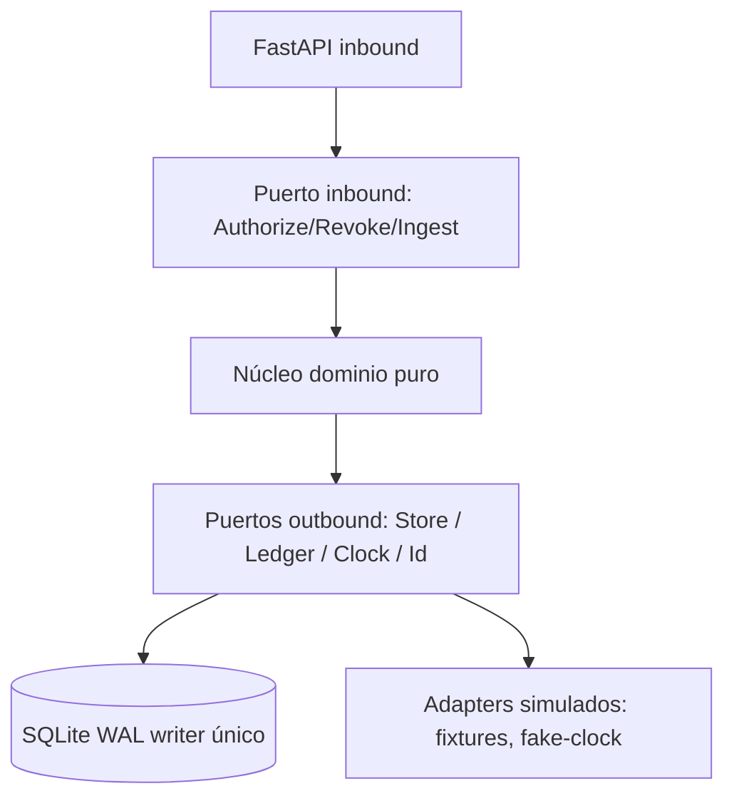

# Architecture Spine — Módulo 1

## Design Paradigm

Hexagonal con núcleo de dominio puro. El dominio decide autorización, transiciones de membresía y validación de lote sin conocer HTTP, SQL ni el reloj; todo efecto entra por puertos. Mapa a código:

```text
solu2-module1/
  domain/    # resolución, validación de lote, máquina de estados; sin fastapi/sqlalchemy/datetime.now/random/red
  ports/     # Clock, IdGenerator, MembershipStore, CredentialStore, LedgerWriter, RegistrarSource, TelemetryPort
  adapters/  # fastapi (inbound), sqlalchemy-sqlite (driven), fake-clock + fixtures (simulados)
  dto/       # primitivos por operación + ErrorBody + ExplanationDTO
```



## Inherited Invariants

AD-01 a AD-07 de `planning/ARCHITECTURE.md` v1.0.0 son autoridad read-only. No se renumeran ni se debilitan; el detalle de enforcement vive en `contracts.md`.

| Inherited | From parent | Binds here |
| --- | --- | --- |
| AD-01 Context Isolation & Binding | planning/ARCHITECTURE.md | resolveEffectivePermissions: comparación cruda byte-a-byte del valor de `X-Academic-Subject-Context` contra el subject del ARN (AD-01 sin cambiar; normalización retirada) |
| AD-02 Ingestión atómica + anti-role-smuggling | planning/ARCHITECTURE.md | ingestRoster: BEGIN IMMEDIATE, seen_ids, rollback total |
| AD-03 Invalidación determinista + idempotencia | planning/ARCHITECTURE.md | revokeCourseAccess: workers 1, busy_timeout 5000, ALREADY_REVOKED |
| AD-04 Ledger encadenado + metadata singleton | planning/ARCHITECTURE.md | las tres operaciones: evento por mutación/decisión, fórmula normativa AD-04 §5 (con `subject_id`/`action`; resumen §2 incompleto) + codec local (`0x00` null / `0x01`+len8BE+UTF-8 por campo en orden, SHA-256; timestamp `YYYY-MM-DDTHH:mm:ss.ffffffZ`; prev hex minúsculas; FIFO-`id ASC`; génesis `prev` = semilla `e3b0c44298fc1c149afbf4c8996fb92427ae41e4649b934ca495991b7852b855` de ARCHITECTURE.md l.97 [ADOPTED 2026-10-14, estudiante] (R10-M2, corrige H-15)), verificación por id ASC |
| AD-05 Anti auto-aprobación + exclusión mutua | planning/ARCHITECTURE.md | resolve: lectura de ticket vigente; índice único parcial como guarda física |
| AD-06 Cero secretos en trazas | planning/ARCHITECTURE.md | todas las salidas/logs: solo uai_live_<4>••••<4>, test regex de build |
| AD-07 Paginación acotada | planning/ARCHITECTURE.md | consultas de respaldo a estados Empty/Error de roster y auditoría |

## Invariants & Rules

### AD-08 — Pureza del dominio hexagonal

- **Binds:** las tres operaciones, todo código bajo `domain/`
- **Prevents:** que dos unidades importen cada una su propio acceso a framework/reloj/azar y diverjan en testeabilidad
- **Rule:** `domain/` no puede usar NINGUNA fuente de no-determinismo: `fastapi`, `sqlalchemy`, clientes de red, `random`, `secrets`, `uuid`, `os.urandom`, `time.*`, `datetime.now/utcnow/today` [ADOPTED 2026-10-13, estudiante] (H-25). Tiempo solo por el puerto `Clock`; IDs y azar solo por `IdGenerator`. Los DTO de puerto usan solo tipos primitivos.

### AD-09 — Mapeo canónico operación↔HTTP

- **Binds:** las tres operaciones, routers FastAPI
- **Prevents:** que cada unidad elija una ruta distinta entre las variantes que conviven en PRD/arquitectura, o que un DENY se sirva 200 en una unidad y 403 en otra
- **Rule:** mapeo único: `resolveEffectivePermissions` ↔ `POST /api/v1/authorize` con header obligatorio `X-Academic-Subject-Context`; `revokeCourseAccess` ↔ `POST /api/v1/subjects/{subject_id}/enrollments/{student_id}/drop`; `ingestRoster` ↔ `POST /api/v1/subjects/{subject_id}/roster`. Ninguna otra ruta expone estas operaciones. Las tres rutas documentan `401` con `AUTH_TOKEN_INVALID` (token ausente, inválido o expirado; primero en el orden). Ronda 6 [ADOPTED 2026-10-13]: `revokeCourseAccess` e `ingestRoster` exigen rol institucional `admin` (`403 ADMIN_ROLE_REQUIRED` después del 401 y antes de la sintaxis; Q1, ADVF-01); el `action` de `/authorize` es el enum `inference`/`training` (`400 MALFORMED_ACTION`, Q5); el token se valida por `TokenVerifierPort` (Q2) [ADOPTED 2026-10-13, estudiante] (R3-01). Transporte [ADOPTED 2026-10-13, corrección usuario]: endpoint público sin `at` en el body —el adapter captura `Clock.now()` una vez por solicitud (`request_now`) para la evaluación en vivo; `at` de Annex A solo como entrada interna/test/replay (puede ser histórico); `term` únicamente en query (`?term=`) para CSV y únicamente en el body para JSON —ausente, no-string, vacío, en canal indebido, duplicado o discrepante → siempre `MALFORMED_TERM` 400, sin elegir valor; `institutional_id` y `term` case-sensitive según decisión previa; `courseId`/UUID/espacios según reglas ya acordadas. Contexto en rutas [ADOPTED 2026-10-13]: header obligatorio solo en `/authorize`; en revoke/ingest rige el path param canónico sin header adicional; AD-01 sin extender fuera de autorización. Decisión de dominio vs HTTP: el dominio distingue `ALLOW|DENY`; `ALLOW → 200 AuthorizeResponse (decision: ALLOW)` y todo `DENY` de política → `403 DenyBody` RFC-7807 con `decision: DENY` + `ExplanationDTO` obligatoria (PRD §5.2, ARCH §4.2/AD-01). Queda prohibido retornar `decision: DENY` en un `200`: el `200` de `POST /api/v1/authorize` porta solo `AuthorizeResponse` con `decision: ALLOW`. Transporte [ADOPTED 2026-10-13, estudiante]: `term` con decode-once RFC 3986 + comparación exacta (H-18); path sin gramática extra — segmento exacto o `404 UNKNOWN_COURSE` (H-18); header repetido o vacío = ausente → `SUBJECT_CONTEXT_MISSING_OR_UNAUTHORIZED`, valor del parser sin más normalización (H-24); `request_now` capturado una vez al entrar al adapter pre-auth y reutilizado en `roster.rejected` (H-16); `timestamp` de baja en el body JSON, informativo, instante efectivo del `Clock` (F-05); ausente o fuera de la gramática RFC 3339 UTC (R4-01, G9-01, G9-04) → `400 MALFORMED_DROP_TIMESTAMP` (o más de 300 s posterior a `request_now`, Q6 / ECF-13 [ADOPTED 2026-10-13]) (`MALFORMED_DROP_REASON` primero si ambos fallan; ambos en `rule_ids`) (R3-02); cuerpo 422 siempre `application/problem+json`, se ignora `Accept` (R3-05) [ADOPTED 2026-10-13, estudiante].

### AD-10 — Fixture del Mandatory Edge Case y aislamiento por contexto

- **Binds:** resolveEffectivePermissions, EDGE-01, suites ATDD
- **Prevents:** unión global de roles que filtraría el rol TA de CS-480 hacia CS101
- **Rule:** el seed canónico fija una identidad con `Student` en `CS101` y `TA` en `CS-480`; cada llamada resuelve solo la tupla `(identity_id, course_id)` declarada y nunca importa el rol de otro curso. `resolveEffectivePermissions` no devuelve cuota GPU ni prioridad de scheduling: esos campos pertenecen a otros módulos ([ASSUMPTION-01] del PRD). Se rechaza la aserción del edge-case hunter crudo que iguala ambos contextos a `Student`. `effective_role` = identificador exacto de `roles.id` en el DDL, sin transformar [ADOPTED 2026-10-13, estudiante] (H-26).

### AD-11 — Decisión automática explicable con regla citada

- **Binds:** resolveEffectivePermissions, revokeCourseAccess, ingestRoster, banners E-01 a E-04
- **Prevents:** veredictos opacos que cada unidad explicaría con un formato propio
- **Rule:** todo `ALLOW`/`DENY` y todo rechazo de negocio 409/422 de lote/baja (incluido `ALREADY_REVOKED` con AD-03) porta `ExplanationDTO` con `rule_ids` no vacío (AD-n citado), valores observados y umbral aplicado. El `reason_code` pertenece al enum cerrado del catálogo de `contracts.md` (28 códigos tras R3-01/R3-02 y Ronda 6: `ADMIN_ROLE_REQUIRED` 403, `MALFORMED_ACTION` 400 [ADOPTED 2026-10-13]); ningún código fuera del catálogo llega a la respuesta. `AUTH_TOKEN_INVALID` → 401 primero en el orden (R3-01); `MALFORMED_DROP_TIMESTAMP` → 400 en el paso de sintaxis P3/P4 (R3-02). Mapeo ledger (R3-03): `membership.revoked` → `DENY`/`SUBJECT_ENROLLMENT_DROPPED`; `escalation.expired` → `DENY`/`STATUS_ESCALATION_EXPIRED`. El 201 de ingesta no porta `ExplanationDTO` (un éxito de mutación se describe con conteos) [ADOPTED 2026-10-14, estudiante] (R8-02). Errores 400/401/404 y 413/503 usan `ErrorBody` tipado sin `ExplanationDTO` obligatoria [ADOPTED 2026-10-13]; sin códigos nuevos salvo la excepción aprobada R3-01/R3-02. `rule_ids` = TODAS las reglas violadas ordenadas por precedencia (primero = `code` principal); observados solo de esas reglas (H-23). `500 AUDIT_LOG_TAMPERING_DETECTED` usa `ErrorBody` sin `ExplanationDTO` (F-06). `ErrorBody.rule_ids` opcional [ADOPTED 2026-10-13, estudiante] (R4-02): solo si falla más de una regla de sintaxis en la misma petición, ordenado por precedencia (primero == `code`); sin `ExplanationDTO` en 400. [ADOPTED 2026-10-13, estudiante]. Precedencia de sintaxis en `ingestRoster` [ADOPTED 2026-10-13, estudiante] (G9-02): `BATCH_TOO_LARGE` 413 antes de parsear; luego `MALFORMED_TERM` > `MALFORMED_BATCH` > `BATCH_EMPTY`. Serialización [ADOPTED 2026-10-13, estudiante] (G9-03): campos opcionales ausentes se omiten, nunca `null` (`exclude_none`); `ErrorBody.rule_ids` y `ExplanationDTO.threshold` no-nullable.

### AD-12 — Serialización de carreras e idempotencia observable

- **Binds:** revokeCourseAccess, ingestRoster, resolveEffectivePermissions concurrente con revoke
- **Prevents:** doble mutación por reintento/doble-clic y lecturas autorizadas con estado obsoleto
- **Rule:** la revocación sigue AD-03 heredado: proceso único (`workers: 1`), actualización persistente y propagación a `revoked_credentials_cache` en <200 ms; la alternativa de DB como única autoridad sin caché queda eliminada. Orden en revoke (R3-06): validar (P1-P4) → `BEGIN IMMEDIATE` → `UPDATE … WHERE status='ACTIVE' RETURNING` + `QueueReservation` → commit → publicar evento. Append-only físico de `audit_ledger` y `audit_events` con triggers `BEFORE UPDATE`/`BEFORE DELETE` → `RAISE(ABORT, 'append-only')` (R3-06). La baja repetida sobre membresía `DROPPED` retorna receipt estable `ALREADY_REVOKED` sin mutación ni evento redundante. La ingestión es todo o nada: STRICT = abortar el lote completo (rollback total, 422 con manifiesto); no existe modo "segregar" (R3-04). Reingesta [ADOPTED 2026-10-13]: sin idempotencia por contenido ni deduplicación por hash; cada solicitud válida es un intento nuevo con `batch_id` nuevo, conteos en transacción serializada (`BEGIN IMMEDIATE`); 8hex sin garantía anti-colisión; colisión resuelta: UNIQUE `roster_batches.batch_id` + reintento IdGenerator x3 → 503 [ADOPTED 2026-10-13, estudiante] (F-04); regeneración/reemisión de credenciales pendiente si afecta el contrato. Las escrituras usan `BEGIN IMMEDIATE` [ADOPTED 2026-10-13]; queda prohibido el patrón leer y luego actualizar en dos pasos y se elimina la disyunción con sentencia condicional única. Replay [ADOPTED 2026-10-13, estudiante] (F-01): sintaxis P3 primero — `drop_reason` inválido → 400 aunque esté `DROPPED`; solo replay válido → `ALREADY_REVOKED`. `batch_id` solo tras auth/tamaño/UTF-8/estructura/`term` (400/401/413 sin `batch_id`); UNIQUE `roster_batches.batch_id` + reintento IdGenerator x3 → 503 (F-04). Lecturas de `authorize` en UNA transacción de lectura (snapshot WAL); la caché solo adelanta DENY, nunca ALLOW; 503 solo ante `busy_timeout` agotado (H-22).

### AD-13 — Frontera temporal semiabierta con reloj inyectado

- **Binds:** resolveEffectivePermissions con escalación vigente, expiración de privilegios
- **Prevents:** que el borde de expiración y la fuente del reloj se definan de forma distinta por unidad (pared vs monotónico vs fixture)
- **Rule:** la vigencia es el intervalo `[granted_at, expires_at)`; `at >= expires_at` es expirado y retorna `DENY STATUS_ESCALATION_EXPIRED` (mapeado 403 DenyBody). Con ticket `REVOKED`, el intervalo efectivo es `[granted_at, min(expires_at, revoked_at))` (`escalation_tickets.revoked_at`, con `CHECK ((status <> 'REVOKED') OR (revoked_at IS NOT NULL))`); si `at >= revoked_at`, el ticket no aplica [ADOPTED 2026-10-13, estudiante] (G6-01). La expiración la ejecuta el scheduler interno que auto-revoca al vencer (PRD §4.2 R5, l.162) [ADOPTED 2026-10-13]; `resolve` deniega desde `now >= expires_at` (PRD §7.1 l.317-318) aunque el scheduler aún no haya actualizado el estado persistido. Frecuencia [ADOPTED 2026-10-13, estudiante]: barrido cada 1 s (tests con `fake_clock`), no alternativa a la expiración automática. El scheduler es el único dueño de la mutación persistida a expirado (máximo un evento por transición efectiva); actualiza condicionalmente solo `ACTIVE` con `granted_at <= now` y `expires_at <= now` (`granted_at > now` aún no expira); `resolve` no muta y evalúa contra el `at` pedido (incluso histórico); el scheduler evalúa contra su reloj actual. `DROPPED` impide autorización sin nueva mutación del ticket fuera de AD-03. Recuperación de crash [ADOPTED 2026-10-13, estudiante]: al reiniciar barre todo `ACTIVE` con `expires_at <= now` (ver final de la Rule), sin promesa exactly-once más allá de un evento por transición. En vivo rige el `request_now` capturado (la vía pública no tiene `at`); en vía interna, `at` histórico válido evalúa en ese instante y `null`/vacío/espacios/sin zona/sin microsegundos → `INVALID_AT`; el scheduler usa su reloj propio. La expiración solo perezosa deja de ser alternativa equivalente. El dominio recibe el instante por el puerto `Clock` (UTC ISO-8601 con microsegundos), nunca del cliente en vivo. Replay [ADOPTED 2026-10-13, estudiante] (H-21): con `at` histórico mandan el intervalo `[granted_at, expires_at)` y la columna `revoked_at` del ticket; un ticket `REVOKED` aplica solo en `[granted_at, min(expires_at, revoked_at))`; si `at >= revoked_at`, no aplica [ADOPTED 2026-10-13, estudiante] (G6-01); `granted_at` futuro → rol base; intervalo vacío imposible por DDL. Scheduler con barrido cada 1 s (tests con `fake_clock`); tras crash, al reiniciar barre todo `ACTIVE` con `granted_at <= now` y `expires_at <= now` vía `UPDATE … WHERE status='ACTIVE' … RETURNING`, un evento por transición (idempotente). Transición `ACTIVE→EXPIRED` y su evento [ADOPTED 2026-10-13, estudiante] (G6-02): patrón `QueueReservation` (reserva antes del commit, publica tras el commit); tras un crash, al reiniciar el scheduler reconcilia —por cada ticket `EXPIRED` sin evento `escalation.expired` en el ledger para ese ticket, emite exactamente uno (idempotente por id de ticket)—; resultado garantizado: exactamente 1 evento por transición. Si el barrido no puede reservar cola: log WARN estructurado (sin secretos) + métrica `scheduler_sweep_deferred_total`, reintento en el siguiente barrido de 1 s — DEFER a NFR (Test-lead, Fase 3 `/bmad-testarch-nfr`) [ADOPTED 2026-10-13, estudiante] (G7-02). Migración G7-01 REJECT: `001_module1_schema.sql` es la migración inicial; no existe DB previa que migrar; futura migración 002 debe rellenar `revoked_at` antes de activar el CHECK [ADOPTED 2026-10-13, estudiante] (G7-01).

## Consistency Conventions

| Concern | Convention |
| --- | --- |
| Naming (entidades, archivos, interfaces, eventos) | IDs y operaciones en inglés del dominio (`resolveEffectivePermissions`, `revokeCourseAccess`, `ingestRoster`); docs en español; `subject_id` canónico en mayúsculas (`CS101`, `CS-480`) |
| Data & formats (ids, dates, error shapes, envelopes) | `userId` acepta UUID o `institutional_id`; resolución a identidad canónica en el adapter. Decisión local [ADOPTED] 2026-10-13 (usuario): `institutional_id` y `term` se manejan case-sensitive exacto, sin case-folding ni conversión automática (`stu-98432` ≠ `STU-98432`; `2026-fall` ≠ `2026-FALL`); gramática de `institutional_id` `^[A-Za-z0-9-]{1,64}$` (Q7 / ADVF-21 [ADOPTED 2026-10-13]); alcance limitado a esos dos campos — no se extiende a `courseId` (regla byte-a-byte adoptada aparte) ni toca AD-01..AD-07; UUID solo canónico `8-4-4-4-12` con guiones (hex en cualquier case, normalizado a minúscula para buscar); llaves, URN, sin guiones, whitespace y controles rechazados sin `strip`; si no, `institutional_id` exacto. Normalización [ADOPTED 2026-10-13]: `institutional_id`, `term` y `seen_ids` case-sensitive exactos; dominio de email case-insensitive (resto del email intacto, sin reescribir); sin case-folding en otros campos. Límites [ADOPTED 2026-10-13]: 5.000.000 bytes del body recibido (incl. envelope/header; bytes reales, no solo `Content-Length`); 1000 filas de datos (sin header ni terminador vacío; vacía intermedia cuenta y se rechaza); exceso → 413 antes de filas; `drop_reason` 1–280 puntos Unicode (no bytes/graphemes), solo-espacios inválida, original intacto sin normalizar. Regla [ADOPTED] 2026-10-13 para `courseId` (AD-01 heredado l.329-331, sin modificar): comparación byte-a-byte del valor crudo del header contra el subject del ARN, sin `strip`/`upper`/normalización; cualquier diferencia —incluida mayúsculas/minúsculas— es mismatch y deniega; normalización retirada como alternativa. Fechas UTC ISO-8601 con microsegundos. Errores RFC-7807 con `CODE` del catálogo; DENY de política en 403 DenyBody. |
| State & cross-cutting (mutation, errors, logging, config, auth) | fail-closed ante fallo del store (`AUTH_INTERNAL_POLICY_UNAVAILABLE` 503). Rechazo roster 422 [ADOPTED 2026-10-13]: rollback total y después evento `roster.rejected` en tx separada; evento no aceptado en cola → 503 sin descarte silencioso. El rechazo integra la misma cadena única `audit_ledger` (1:1 con `audit_events`, afecta el siguiente `prev_record_hash`); 422 tras aceptación en cola sin espera de persistencia; sin segunda cadena, ledger ni log paralelo. Cola [ADOPTED 2026-10-13]: micro-batching heredado AD-04.3 (worker secuencial, flush cada 50 ms o 50 eventos), sin descarte silencioso; cola llena antes de responder → 503 fail-closed; capacidad máxima pendiente TEA/NFR; recuperación tras fallo de persistencia pendiente (fuentes no fijan protocolo). Mutantes reservan/confirman espacio de cola antes del commit (evento no aceptado → 503 sin mutación); `resolve` con evento obligatorio no aceptado → 503; aceptado → la respuesta puede preceder a la persistencia (AD-04.3). Puerto `QueueReservation` [ADOPTED 2026-10-13]: reserva espacio antes del commit; sin espacio → 503 sin mutación; tx fallida → libera; tx confirmada → publica el evento reservado; `resolve` no responde ALLOW/DENY antes de aceptar su evento. Respuesta tras revocación [ADOPTED 2026-10-13]: `403 SUBJECT_ENROLLMENT_DROPPED` (elección unificada; el PRD admite 401 o 403). Precedencia auth [ADOPTED 2026-10-13]: primero autenticación (401), luego contexto/membresía (403). Una sola captura `request_now` por request (evaluación, timestamps, `occurredAt`); lecturas de `authorize` en UNA transacción de lectura — snapshot WAL — (caché solo adelanta DENY, nunca ALLOW; 503 de lector solo ante `busy_timeout` agotado) [ADOPTED 2026-10-13, estudiante] (H-22, H-16). Secretos solo en claro en la emisión inicial; después enmascarados. Credenciales de ingesta: una `uai_live_` por cada membresía que el lote deja `ACTIVE` en el curso, por par identidad-materia [ADOPTED 2026-10-14, estudiante] (R8-01). Auditoría con `eventId`, `occurredAt` UTC, `schemaVersion` |

## Stack

| Name | Version |
| --- | --- |
| Python | 3.11+ (mínimo heredado; runtimes posteriores aceptados) |
| FastAPI | 0.143.0 |
| Pydantic | 2.14.1 (v2) |
| SQLAlchemy | 2.0.54 (línea 2.0; no migrar a 2.1) |
| SQLite WAL | versión del runtime de despliegue (writer único, `busy_timeout 5000`) |
| pytest + pytest-asyncio + hypothesis | harness ATDD (scaffold, RED por `NotImplementedError`) |

## Structural Seed

```text
solu2-module1/
  planning/detailed-design/architecture-spine/  # este spine + .memlog.md + reviews/
  planning/detailed-design/contracts.md         # P/Q/I por operación + catálogo de errores
  domain/ ports/ adapters/ dto/                 # futuros stubs (sin lógica productiva aún)
  test/atdd/                                    # suite RED futura
```

## Capability → Architecture Map

| Capability / Area | Lives in | Governed by |
| --- | --- | --- |
| Resolución efectiva de permisos + EDGE-01 | domain/resolution + adapter authorize | AD-01, AD-08, AD-10, AD-11, AD-13 |
| Baja y revocación sub-minuto | domain/membership + adapter enrollments | AD-03, AD-08, AD-11, AD-12 |
| Ingestión atómica de nómina | domain/roster + adapter roster | AD-02, AD-08, AD-11, AD-12 |
| Ledger y no-repudio | LedgerWriter + audit_ledger(+metadata) + TABLA audit_events 1:1 | AD-04, AD-06 |
| Explicabilidad UX (E-01–E-04) | ExplanationDTO en dto/ | AD-11 |

## Deferred

- Migración de SQLite a PostgreSQL si el benchmark del NFR de concurrencia lo exige; dueños Architect-lead + Test-lead, condición: medición real, nunca suposición.
- Guard monotónico NTP (`time.monotonic`) para expiración (ARCH-EDGE-03, DEFER post-V1 del triage).
- Barrido inter-semestral `INACTIVE` de [ASSUMPTION-03] y producción de `COMPLETED`/`EXPIRED` de llaves sin TTL (ajenos a las tres operaciones; `COMPLETED` decidido como no-activa → DENY [ADOPTED 2026-10-13, estudiante]).
- Flujos exclusivos de escalación (solicitud/aprobación) y deep-link UX más allá de lo que tocan las tres operaciones.
- Capacidad numérica de cola y recuperación post-aceptación: DEFERRED a Fase 3 NFR (`/bmad-testarch-nfr`), responsable Test-lead; hasta entonces cola llena → 503 [ADOPTED 2026-10-13, estudiante]. Barrido sin reserva de cola: mismo DEFER con log WARN estructurado (sin secretos) + métrica `scheduler_sweep_deferred_total` y reintento en el siguiente barrido de 1 s [ADOPTED 2026-10-13, estudiante] (G7-02). Migración con `revoked_at` NULL: REJECT — `001_module1_schema.sql` es migración inicial sin DB previa; futura 002 debe rellenar `revoked_at` antes del CHECK [ADOPTED 2026-10-13, estudiante] (G7-01).
- TTL `uai_live_…` y regeneración/reemisión de credenciales: DEFERRED, fuera de las tres operaciones; responsable dueño de credenciales (Módulo 1 futuro) [ADOPTED 2026-10-13, estudiante].
- Telemetría GPU: el Módulo 1 no la consume para decidir; `TelemetryPort.emit_metric` solo emite métricas operativas (R8-06, [ASSUMPTION-01] PRD) [ADOPTED 2026-10-14, estudiante].
- Matriz rol×acción completa: v0 cerrada (`schemas/roles_matrix.v0.json`, F-02; roles = `roles.id` exactos del DDL [ADOPTED 2026-10-13, estudiante] (R2-01)); filas no citables DEFERRED al equipo fuente de políticas, fail-closed mientras tanto [ADOPTED 2026-10-13, estudiante].
- Cuota GPU y prioridades de scheduling: fuera del Módulo 1 por [ASSUMPTION-01].
