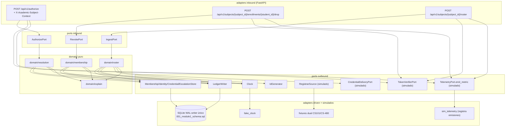

# ports-and-adapters.md — Mapeo hexagonal del Módulo 1 (Fase 2)

Companion de `architecture-spine/ARCHITECTURE-SPINE.md` y `contracts.md`.
Alcance: exactamente las tres operaciones confirmadas el 2026-10-12 —
`resolveEffectivePermissions(userId, courseId, at)`, `revokeCourseAccess(userId, courseId)`,
`ingestRoster(batch)`. Nada de otros módulos. Sin lógica productiva (stop-point solutioning).

AD-01..AD-07 de `planning/ARCHITECTURE.md` v1.0.0 son autoridad read-only; se preservan tal cual.
AD-08..AD-13 son locales del spine. El triage
(`reviews/review-arch-implementability.md`) y el informe Winston
(`reviews/review-agent-architect.md`) se usan solo como propuesta, salvo operaciones y stack confirmados.

Stack confirmado: Python 3.11+, FastAPI 0.143.0, Pydantic 2.14.1, SQLAlchemy 2.0.54,
SQLite WAL writer único (`busy_timeout 5000`). Ver `.work/stack-verification.md`.

## 1. Mapa de capas (cada componente aparece exactamente una vez)

| Componente | Capa | Operación | Contratos | AD | Test RED (intención) |
|---|---|---|---|---|---|
| `domain/resolution` (evaluador contexto + rol efectivo + guarda intervalo) | domain/ | resolveEffectivePermissions | contracts §1 P/Q/I | AD-01, AD-05, AD-08, AD-10, AD-11, AD-13 | `test_edge01_context_isolation`, `test_escalation_boundary_expires`, `test_arn_grammar_rejects` |
| `domain/membership` (transición ACTIVE→DROPPED + revocación masiva) | domain/ | revokeCourseAccess | contracts §2 P/Q/I | AD-03, AD-08, AD-11, AD-12 | `test_revoke_all_credentials`, `test_revoke_replay_idempotent`, `test_revoke_preserves_other_course`, `test_revoke_store_failure_closed` |
| `domain/roster` (validación lote + `seen_ids` + guarda anti-smuggling) | domain/ | ingestRoster | contracts §3 P/Q/I | AD-02, AD-05, AD-08, AD-11, AD-12 | `test_roster_row85_rollback`, `test_roster_no_role_smuggling`, `test_roster_intra_batch_duplicate` |
| `domain/explain` (constructor ExplanationDTO, sin secreto) | domain/ | las tres | contracts §1–§3 Q4 | AD-06, AD-11 | `test_explain_assert_rule_cited`, `test_no_secret_leak` |
| Puerto inbound `AuthorizePort.resolve(user_id, course_id, resource_arn, action, at)` | ports/ (inbound) | resolve | contracts §0–§1 | AD-09 | test de rutas: solo `POST /api/v1/authorize` expone resolve (endpoint público sin `at`; `at` solo interno/test/replay) |
| Puerto inbound `RevokePort.drop(user_id, course_id, drop_reason)` | ports/ (inbound) | revoke | contracts §2 | AD-09 | test de rutas: solo `POST …/enrollments/…/drop` expone revoke |
| Puerto inbound `IngestPort.ingest(subject_id, term, rows)` | ports/ (inbound) | ingest | contracts §3 | AD-09 | test de rutas: solo `POST …/roster` expone ingest |
| Puerto outbound `MembershipStore`, `IdentityStore`, `CredentialStore`, `EscalationStore` | ports/ (outbound) | las tres | contracts §1–§3 | AD-02, AD-03, AD-05, AD-12 | tests de carrera/replay roster/revoke |
| Puerto outbound `LedgerWriter.append(event)` | ports/ (outbound) | las tres | contracts §1–§3 Q3 | AD-04 | `test_ledger_chain_and_anchor` |
| Puerto outbound `Clock.now()` (UTC ISO-8601 microsegundos; captura única `request_now` por solicitud) | ports/ (outbound) | resolve/revoke/ingest | contracts §0–§1 Tiempo | AD-08, AD-13 | `test_escalation_boundary_expires` (fake-clock) |
| Puerto outbound `QueueReservation` (reserva/publica/libera espacio de cola) | ports/ (outbound) | las tres | contracts §5 | AD-04, AD-12 | test de reserva de cola (pendiente TEA) |
| Puerto outbound `IdGenerator.new_id()` (`batch_id` solo tras auth/tamaño/UTF-8/estructura/`term`; 400/401/413 sin `batch_id`) | ports/ (outbound) | ingest | contracts §3 Q1 | AD-08 | formato `roster-<8hex>-<term>`; UNIQUE `roster_batches.batch_id` + reintento x3 → 503 [ADOPTED 2026-10-13, estudiante] (F-04) |
| Puerto outbound `RegistrarSource` (origen baja / nómina externa, simulado) | ports/ (outbound) | revoke/ingest | PRD §4.1/§4.3 | — | — |
| Puerto outbound `TelemetryPort.emit_metric(name: str, value: float, labels: dict[str, str]) -> None` (outbound, simulado; registra emisiones) [ADOPTED 2026-10-14, estudiante] (R8-06) | ports/ (outbound) | las tres (métricas operativas: latencias, `scheduler_sweep_deferred_total`) | PRD [ASSUMPTION-01] | AD-06 | — |
| Puerto outbound `TokenVerifierPort.verify(bearer)` → `{actor_id, actor_role}` o fallo (simulado, tokens de fixture) [ADOPTED 2026-10-13, Ronda 6 Q2] (ADVF-02) | ports/ (outbound) | las tres | contracts §0, §4 `AUTH_TOKEN_INVALID` | AD-06 | 401 `AUTH_TOKEN_INVALID` si falla; `actor_role = admin` exigido por Q1 en revoke/ingest |
| Puerto outbound `CredentialDeliveryPort.enqueue(identity_id, raw_key)` (simulado, outbox en memoria) [ADOPTED 2026-10-13, Ronda 6 Q4] (ADVF-16 DEFER) | ports/ (outbound) | ingest | contracts §3 Q2 | AD-06 | 201 sin claves; solo se persiste el hash; un `enqueue` por credencial de membresía `ACTIVE` que deja el lote [ADOPTED 2026-10-14, estudiante] (R8-01) |
| Adapter inbound `adapters/http_authorize` (FastAPI `POST /api/v1/authorize`) | adapters/ inbound | resolve | contracts §0 | AD-01, AD-09 | `test_edge01_context_isolation` (HTTP) |
| Adapter inbound `adapters/http_enrollments` (FastAPI `POST /api/v1/subjects/{subject_id}/enrollments/{student_id}/drop`) | adapters/ inbound | revoke | contracts §0/§2 | AD-03, AD-09 | `test_revoke_replay_idempotent` (HTTP) |
| Adapter inbound `adapters/http_roster` (FastAPI `POST /api/v1/subjects/{subject_id}/roster`) | adapters/ inbound | ingest | contracts §0/§3 | AD-02, AD-09 | `test_roster_row85_rollback` (HTTP) |
| Adapter driven `adapters/sqlite_store` (SQLAlchemy 2.0 → `schemas/001_module1_schema.sql`) | adapters/ driven | las tres | contracts §1–§3 Concurrencia | AD-02, AD-03, AD-04, AD-05, AD-12 | tests de carrera + cadena ledger; lookup de credencial por `key_prefix` + verificación SHA-256(salt‖raw) tras el match (ADVF-17/ECF-18) |
| Adapter driven `adapters/ledger_writer` (cola async FIFO + `QueueReservation`; micro-batching 50 ms/50 ev) | adapters/ driven | las tres | contracts Q3 | AD-04 | `test_ledger_chain_and_anchor` |
| Adapter simulado `adapters/fake_clock` | adapters/ simulado | las tres | Tiempo | AD-08, AD-13 | boundary expires |
| Adapter simulado `adapters/fixtures` (seed dual CS101/CS-480 + CSV 120; `seed_fleet` se conserva como fixture exigida por la consigna para módulos que la usen) [ADOPTED 2026-10-14, estudiante] (R8-06) | adapters/ simulado | resolve/ingest | EDGE-01 | AD-10 | `test_edge01_context_isolation` |
| Adapter simulado `adapters/sim_telemetry` (implementa `TelemetryPort`; registra las emisiones) [ADOPTED 2026-10-14, estudiante] (R8-06) | adapters/ simulado | las tres | PRD [ASSUMPTION-01] | AD-06 | — |
| Adapters simulados `adapters/fake_token_verifier` y `adapters/fake_credential_outbox` [ADOPTED 2026-10-13, Ronda 6 Q1/Q2/Q4] | adapters/ simulado | las tres / ingest | contracts §0, §3 Q2 | AD-06 | 401 con token inválido; el Department Chair (Dr. Marcus Vance) y el principal de servicio del SIS simulado se aprovisionan con `admin` |
| Seeds de roles y subjects (ADVF-25) | adapters/ fixtures (no DDL) | las tres | contracts §5 (FK) | — | test de FK sobre la fixture; el DDL no contiene seeds de catálogo |
| DTO `dto/` (primitivos + `ErrorBody` + `ExplanationDTO`) | dto/ | las tres | contracts §4–§5 | AD-06, AD-11 | `test_explain_assert_rule_cited` |

Reglas hexagonales (AD-08): `domain/` no importa `fastapi`, `sqlalchemy`, clientes de red,
`datetime.now`, ni `random`. Tiempo y azar solo por `Clock` / `IdGenerator`.
DTO y firmas de puerto usan solo tipos primitivos (`str`, `int`, listas, dicts planos).
Todo lo GPU/telemetría/K8s/vLLM/identidad real va tras puertos con adapters simulados.
Alcance [ADOPTED 2026-10-13, estudiante] (H-25): NINGUNA fuente de no-determinismo en `domain/` — `random`, `secrets`, `uuid`, `os.urandom`, `time.*`, `datetime.now/utcnow/today`; tiempo solo por `Clock`, IDs/azar solo por `IdGenerator`; la lista del lint se amplía.
Modos de fallo de puertos (R12-B01 [ADOPTED 2026-10-14, estudiante], hallazgo SEC B-01): ningún puerto de infraestructura falla abierto. Para `Clock`, `IdGenerator` y `QueueReservation` (adapters simulados `fake_clock`, `fake_id_generator`, `fake_queue`; fakes que lanzan en `test/fakes/fake_failing_ports.py`), una excepción o indisponibilidad la traduce el adapter inbound a `503 AUTH_INTERNAL_POLICY_UNAVAILABLE` (reintentable) antes de cualquier commit; el dominio nunca recibe un instante por defecto, un ID vacío ni un ALLOW por omisión. `LedgerWriter` mantiene la regla de §4 (rollback total, fail-closed). Tests RED: `test_resolve_clock_failure_503_fail_closed_no_decision_no_mutation` (resolve) y `test_ingest_id_generator_failure_503_no_writes_no_credentials` (ingest). Revoke: mismo criterio, test RED T-REV-12 `test_revoke_clock_failure_503_fail_closed_no_mutation` (E2-S3) [ACTUALIZADO 2026-10-14, K-19].

## 2. Diagrama de capas y flujo

## 3. Transporte HTTP canónico (AD-09) y supuestos registrados

Rutas canónicas (coinciden con PRD/AD cuando hay autoridad clara; params nombrados como en PRD):

- `POST /api/v1/authorize` — header obligatorio `X-Academic-Subject-Context: <courseId>` (comparación cruda byte-a-byte AD-01, sin normalización),
  body `{ user_id, resource_arn, action }` sin `at`. Sin query para esta operación. El adapter captura `Clock.now()` UNA vez al entrar, antes de autenticar (`request_now`), y lo usa para la evaluación en vivo, timestamps administrativos y `occurredAt`; el worker usa el timestamp del evento. El header es obligatorio solo aquí.
  `request_now` [ADOPTED 2026-10-13, estudiante] (H-16): captura pre-auth; el evento `roster.rejected` de la tx separada reutiliza ese mismo `request_now` como `occurredAt`.
  Header [ADOPTED 2026-10-13, estudiante] (H-24): repetido o presente vacío `""` = ausente → `SUBJECT_CONTEXT_MISSING_OR_UNAUTHORIZED` (paso 3); se compara el valor tal como lo entrega el parser HTTP (RFC 9110); la app no normaliza nada más.
- `POST /api/v1/subjects/{subject_id}/enrollments/{student_id}/drop` —
  path params `subject_id`, `student_id` (fuente canónica; sin header adicional); body `{ drop_reason, timestamp }` (`timestamp` RFC 3339 con zona UTC informativo [ADOPTED 2026-10-13, estudiante] (R4-01), instante efectivo del `Clock` — F-05; ausente o fuera de esa gramática → `400 MALFORMED_DROP_TIMESTAMP`, mismo paso de sintaxis que `drop_reason`, `MALFORMED_DROP_REASON` primero si ambos fallan y ambos en `rule_ids` — R3-02). `drop_reason` 1–280 puntos Unicode; blancos por `str.isspace()`; secreto `uai_live_…` se enmascara (AD-06 gana sobre intacto — H-19). Replay con sintaxis P3/P4 primero: `drop_reason`/`timestamp` inválidos → 400 aunque esté `DROPPED` (F-01 + R3-02). Orden en revoke (R3-06): validar (P1-P4) → `BEGIN IMMEDIATE` → `UPDATE … WHERE status='ACTIVE' RETURNING` + `QueueReservation` → commit → publicar evento. Sin query. [ADOPTED 2026-10-13, estudiante].
  Path [ADOPTED 2026-10-13, estudiante] (H-18): sin gramática extra; el segmento se busca exacto y si no existe → `404 UNKNOWN_COURSE`.
- `POST /api/v1/subjects/{subject_id}/roster` — path param `subject_id` (autoridad);
  CSV (`multipart/form-data`, columnas exactas) con `term` únicamente en query (`?term=`),
  o JSON equivalente con `term` únicamente en el body. `subject_id` del path es autoridad;
  si el body repite `subject_id` y difiere → `MALFORMED_BATCH` 400.
  `term` ausente/tipo/vacío/canal/duplicado/discrepante → siempre `MALFORMED_TERM` 400.
  `term` [ADOPTED 2026-10-13, estudiante] (H-18): decode-once RFC 3986 y luego comparación exacta (`?term=2026-%46ALL` equivale a `2026-FALL`); path con segmento exacto o `404 UNKNOWN_COURSE`.
  `batch_id` [ADOPTED 2026-10-13, estudiante] (F-04): solo tras auth/tamaño/UTF-8/estructura/`term`; 400/401/413 sin `batch_id`; UNIQUE `roster_batches.batch_id` + reintento x3 → 503.
  Anti-smuggling [ADOPTED 2026-10-13, estudiante] (H-20): previa en cualquier estado del mismo `(identity, subject, term)` con rol distinto → 422 con `ROSTER_VALIDATION_FAILED` sobre `assigned_role` (observed/expected; ADVF-14, sin código nuevo) [ADOPTED 2026-10-13, Ronda 6 Q3]; mismo rol sobre `DROPPED`, `SUSPENDED` o `COMPLETED` → sin cambios, sin reactivar, no cuenta como updated (ADVF-15/ECF-23). STRICT [ADOPTED 2026-10-13, estudiante] (R3-04): abortar el lote completo (rollback total, 422 con manifiesto); no existe modo "segregar". Cuerpo 422 siempre `application/problem+json`, sea el input JSON o CSV; se ignora `Accept` [ADOPTED 2026-10-13, estudiante] (R3-05).

[ADOPTED] Reloj/`at`: el endpoint público no acepta `at`; `at` de Annex A vive solo como entrada interna/test/replay (estricto, histórico permitido). Orden único contracts §1 (401 `AUTH_TOKEN_INVALID` primero — R3-01 → 400 → 403 → 404 → 403 → 403 → 403); sin matriz explícita → DENY `UNAUTHORIZED_RESOURCE_CLASS` (matriz externa pendiente, sin permisos inventados).
[ADOPTED 2026-10-13, Ronda 6] Mapeo RequestValidationError → catálogo (ADVF-11, ECF-01/02/03/21/22): el boundary valida la forma del request ANTES de los modelos Pydantic de `dto.py` (que no imponen longitudes ni patrones de negocio), y ningún fallo de forma sale como 422 del framework. `action` fuera del enum → `MALFORMED_ACTION` 400 (Q5); `resource_arn` → `MALFORMED_RESOURCE_ARN` 400; `drop_reason` vacío, solo blancos, con caracteres de control o >280 → `MALFORMED_DROP_REASON` 400; `timestamp` → `MALFORMED_DROP_TIMESTAMP` 400; `term` → `MALFORMED_TERM` 400; roster: bytes o filas por encima del límite → `BATCH_TOO_LARGE` 413 antes de parsear; `rows` vacío o CSV sin filas → `BATCH_EMPTY` 400; columnas, encoding, BOM, Content-Type o partes de multipart → `MALFORMED_BATCH` 400. `user_id` ausente queda DEFERRED (G9-06).
[ADOPTED 2026-10-13, Ronda 6 Q1/Q2] Admin y token: `TokenVerifierPort` resuelve el actor; en `revokeCourseAccess` e `ingestRoster`, `actor_role != admin` → `403 ADMIN_ROLE_REQUIRED` después del 401 y antes de la sintaxis, sin mutación ni evento.
[ADOPTED 2026-10-13, Ronda 6 Q4] Credenciales: `ingestRoster` llama a `CredentialDeliveryPort.enqueue(identity_id, raw_key)`; la respuesta 201 no incluye claves; solo se persiste el hash. [ADOPTED 2026-10-14, estudiante] (R8-01) Una llamada por cada membresía que el lote deja `ACTIVE` en el curso (una credencial por par identidad-materia; corrige R7-03). Telemetría [ADOPTED 2026-10-14, estudiante] (R8-06): `TelemetryPort` solo emite métricas operativas; el Módulo 1 no consume telemetría GPU para decidir ([ASSUMPTION-01] PRD: cuotas en Módulos 2/8).
[ADOPTED 2026-10-14, estudiante] (R9-05) DENY de política se retorna como resultado `{decision: "DENY", ...}` (no excepción); el adapter HTTP lo mapea a 403. [ADOPTED 2026-10-13, estudiante] Precedencia (F-03, H-17): 404 `UNKNOWN_IDENTITY` > `UNKNOWN_COURSE`; 403 `IDENTITY_BARRED` > `RESOURCE_SUBJECT_MISMATCH` > membresía no activa > (`STATUS_ESCALATION_EXPIRED` si el rol base no autoriza y hay ticket del par con `expires_at <= at`; si no, `UNAUTHORIZED_RESOURCE_CLASS`).

[ADOPTED] Receipts: primera baja `200 { student_id, subject_id, status: REVOKED,
revocation_propagated_at }` con `ExplanationDTO`; repetición `200 { student_id, subject_id, status: ALREADY_REVOKED,
revocation_propagated_at: <original> }` con `ExplanationDTO` (AD-03); orden F-01: sintaxis P3 primero (`drop_reason` inválido → 400 aunque esté `DROPPED`; solo replay válido → `ALREADY_REVOKED`), sin mutación ni evento. Clave canónica `revocation_propagated_at` (`revoked_at` solo alias histórico).

## 4. Ledger: `audit_ledger` + TABLA `audit_events` (una sola autoridad hash)

La consigna (Fase 2, Step 2.2) pide TABLA `audit_events`; Plan-2 usa `audit_ledger`
(+ `audit_ledger_metadata` singleton, AD-04). Diseño sin doble autoridad:

- Autoridad única de cadena hash: `audit_ledger` + `audit_ledger_metadata` (DDL en `schemas/001_module1_schema.sql`).
- Fórmula normativa AD-04 §5 + codec [ADOPTED 2026-10-13, estudiante] (H-14, H-15): alcance SOLO los 8 campos §5; enteros futuros como string decimal UTF-8; génesis `prev` = semilla `e3b0c44298fc1c149afbf4c8996fb92427ae41e4649b934ca495991b7852b855` [ADOPTED 2026-10-14, estudiante] (R10-M2: corrige la propuesta previa H-15 "64 ceros"; semilla de Plan-2 `planning/ARCHITECTURE.md` l.97); longitud = bytes UTF-8; frames `0x00` null / `0x01`+len8BE+UTF-8, SHA-256; timestamp `YYYY-MM-DDTHH:mm:ss.ffffffZ`; prev hex minúsculas; orden: aceptación FIFO en cola, `id ASC` persistido. Sin segunda cadena.
- Envelope/payload: TABLA física `audit_events` ligada 1:1 por FK `audit_events.event_id → audit_ledger.event_id`, con `occurred_at`, `schema_version`, `event_type` (`authorization.decided|membership.revoked|roster.ingested|roster.rejected`) y `payload` JSON (ver `events.md` §1–§2). Tipos de evento: `authorization.decided|membership.revoked|roster.ingested|roster.rejected|escalation.expired` (este último: un evento por transición `ACTIVE→EXPIRED` del scheduler, con `QueueReservation` + reconciliación idempotente por ticket [ADOPTED 2026-10-13, estudiante] (G6-02)). No es una segunda cadena/ledger ni una VIEW. La FK solo garantiza la dirección `audit_events → audit_ledger`, no `audit_ledger → audit_events`; no hay `CHECK`/trigger en el DDL que imponga la correspondencia inversa.
- Regla de timestamp consistente (conductual, no del DDL): `audit_events.occurred_at` es byte-a-byte igual a `audit_ledger.timestamp` del mismo `event_id` (ambos del `request_now` capturado pre-auth — H-16, o del `at` interno; el worker nunca reconstruye con `Clock.now()`). La igualdad y la atomicidad dependen del `LedgerWriter`, no de un `CHECK`/trigger del DDL; no se agregan triggers ni restricciones nuevas por suposición.
- Append-only físico [ADOPTED 2026-10-13, estudiante] (R3-06): triggers SQLite `BEFORE UPDATE` y `BEFORE DELETE` sobre `audit_ledger` y `audit_events` → `RAISE(ABORT, 'append-only')` (ver `schemas/001_module1_schema.sql`). Mapeo ledger [ADOPTED 2026-10-13, estudiante] (R3-03): `membership.revoked` → `decision='DENY'`, `reasonCode='SUBJECT_ENROLLMENT_DROPPED'`; `escalation.expired` → `decision='DENY'`, `reasonCode='STATUS_ESCALATION_EXPIRED'`.
- Cola async FIFO + `QueueReservation`: reserva espacio antes del commit; sin espacio → 503 sin mutación; tx fallida → libera; tx confirmada → publica. Micro-batching 50 ms / 50 eventos (AD-04.3); aceptado → la respuesta puede preceder a la persistencia. P1–P4 (formato/auth/identidad) no generan eventos; `resolve` no responde ALLOW/DENY antes de aceptar su evento.
- Escritura de envelope: `LedgerWriter` inserta `audit_ledger` + `audit_events` en la MISMA transacción SQLite (`BEGIN IMMEDIATE` + COMMIT conjunto); fallo en cualquiera → rollback total, fail-closed.
- [OPEN] Capacidad numérica máxima de la cola y recuperación tras fallo de persistencia posterior a la aceptación: DEFERRED Fase 3 NFR (`/bmad-testarch-nfr`), responsable Test-lead. Orden en revoke RESUELTO (R3-06): validar (P1-P4) → `BEGIN IMMEDIATE` → `UPDATE … WHERE status='ACTIVE' RETURNING` + `QueueReservation` → commit → publicar evento. Append-only RESUELTO (R3-06): triggers `BEFORE UPDATE`/`BEFORE DELETE` sobre `audit_ledger` y `audit_events` → `RAISE(ABORT, 'append-only')`. Migración G7-01 REJECT: `001_module1_schema.sql` es migración inicial sin DB previa; futura 002 debe rellenar `revoked_at` antes del CHECK [ADOPTED 2026-10-13, estudiante] (G7-01).
- Ninguna unidad escribe solo en una de las dos tablas.

## 5. Cross-check contrato ⇔ schema (Step 2.3)

| Cláusula I (contracts §5) | AD | Enforcement físico / guarda | Test RED si se retira |
|---|---|---|---|
| Resolución acotada al contexto | AD-01, AD-10 | `domain/resolution` + comparación cruda byte-a-byte header↔ARN (normalización retirada; header repetido/vacío = ausente — H-24) + `CHECK (resource_arn GLOB 'urn:uai:subject:*:model:*')` documental + fixture dual [ADOPTED 2026-10-13, estudiante] | `test_edge01_context_isolation` |
| Gramática ARN, rechazo `.` `/` | AD-01 | parser único boundary con regex exacta `^urn:uai:subject:[a-zA-Z0-9_-]+:model:[a-zA-Z0-9_-]+$` + `CHECK` GLOB documental en `001_module1_schema.sql` + guarda dominio | `test_arn_grammar_rejects` |
| Lote atómico todo o nada | AD-02 | validación previa + `BEGIN IMMEDIATE` + rollback; `UNIQUE(identity_id, subject_id, term)` + índice parcial `idx_single_active_membership` (una ACTIVE por par, Q3/ADVF-13); `batch_id` SOLO tras auth/tamaño/UTF-8/estructura/`term` (400/401/413 sin `batch_id`); UNIQUE `roster_batches.batch_id` + reintento IdGenerator x3 → 503 [ADOPTED 2026-10-13, estudiante] (F-04); 422 con ceros + manifiesto ordenado + precedencia de código + STRICT = abortar lote completo sin segregar (R3-04) + cuerpo siempre `application/problem+json`, se ignora `Accept` (R3-05) | `test_roster_row85_rollback` |
| Sin cambio de rol por importación | AD-02 | guarda `domain/roster` (sin `ON CONFLICT DO UPDATE` de rol) sobre previa en CUALQUIER estado del mismo curso/term; mismo rol sobre `DROPPED` → sin cambios, sin reactivar [ADOPTED 2026-10-13, estudiante] (H-20) | `test_roster_no_role_smuggling` |
| Duplicado intra-lote pre-BD | AD-02 | `seen_ids` exacto en stream (case-sensitive) | `test_roster_intra_batch_duplicate` |
| Revocación masiva del par en una tx | AD-03, AD-12 | `UPDATE … WHERE identity_id AND subject_id` bajo `BEGIN IMMEDIATE` + `busy_timeout 5000`; reserva de cola previa; agotado → 503. Lecturas de `authorize` en UNA transacción de lectura (snapshot WAL); caché solo adelanta DENY, nunca ALLOW; 503 de lector solo ante `busy_timeout` agotado [ADOPTED 2026-10-13, estudiante] (H-22) | `test_revoke_all_credentials` |
| Idempotencia sin evento redundante | AD-03, AD-12 | sintaxis P3/P4 primero (F-01 + R3-02): `drop_reason`/`timestamp` inválidos → 400 aunque esté `DROPPED` (`MALFORMED_DROP_REASON` primero si ambos fallan; ambos en `rule_ids`); solo replay válido → rama `DROPPED → ALREADY_REVOKED` con `ExplanationDTO` (AD-03) [ADOPTED 2026-10-13, estudiante] | `test_revoke_replay_idempotent` |
| Otro curso intacto | AD-03 | predicado por par | `test_revoke_preserves_other_course` |
| Exclusión mutua escalaciones | AD-05 | `UNIQUE INDEX idx_single_active_escalation WHERE status IN (…)` (línea SQL citada) | `test_double_submit_single_ticket` |
| Borde `[granted_at, expires_at)` + Clock | AD-05, AD-13 | scheduler dueño único (barrido 1 s; crash → `UPDATE … WHERE status='ACTIVE' … RETURNING` + un evento por transición; transición `ACTIVE→EXPIRED` con `QueueReservation` + reconciliación `escalation.expired` idempotente por ticket, exactamente 1 evento por transición [ADOPTED 2026-10-13, estudiante] (G6-02)) + guarda intervalo + fake-clock; replay histórico por intervalo y columna `revoked_at` (`[granted_at, min(expires_at, revoked_at))`; `at >= revoked_at` → no aplica [ADOPTED 2026-10-13, estudiante] (G6-01)); `granted_at` futuro → rol base; vacío imposible por DDL [ADOPTED 2026-10-13, estudiante] (H-21). `at` histórico evalúa en ese instante | `test_escalation_boundary_expires` |
| Hash encadenado + metadata singleton | AD-04 | fórmula normativa + codec [ADOPTED 2026-10-13, estudiante] (H-14, H-15): alcance SOLO 8 campos §5, enteros futuros como decimal UTF-8, génesis = semilla e3b0c442…b855 (R10-M2), longitud bytes UTF-8 + `LedgerWriter` tx atómica (`audit_ledger` + `audit_events` 1:1 por FK) + append-only físico con triggers `BEFORE UPDATE`/`BEFORE DELETE` → `RAISE(ABORT, 'append-only')` (R3-06) + mapeo `membership.revoked` → `DENY`/`SUBJECT_ENROLLMENT_DROPPED` y `escalation.expired` → `DENY`/`STATUS_ESCALATION_EXPIRED` (R3-03) + `audit_ledger_metadata(id=1)` + orden `id ASC` + micro-batching 50ms/50ev | `test_ledger_chain_and_anchor` |
| Puerto `QueueReservation` | AD-04, AD-12 | reserva→libera/publica; resolve espera aceptación; P1–P4 sin eventos; capacidad numérica y recuperación post-aceptación DEFERRED Fase 3 NFR (Test-lead) | test de reserva (pendiente TEA) |
| Captura única de reloj + orden | AD-08, AD-09, AD-11, AD-13 | `request_now` capturado al entrar al adapter pre-auth y reutilizado en `roster.rejected` (H-16); precedencias F-03/H-17; orden 401 `AUTH_TOKEN_INVALID` primero (R3-01) →400→403→404→403→403→403; sin regla en matriz → DENY `UNAUTHORIZED_RESOURCE_CLASS` (v0). [ADOPTED 2026-10-13, estudiante] | tests de orden (pendiente TEA) |
| UUID canónico + límites + DTO | AD-09, AD-02, AD-11 | UUID 8-4-4-4-12 minúsculas; `term` decode-once + siempre 400 (H-18); 5.000.000 bytes/1000 filas/Unicode; `drop_reason` isspace + máscara (H-19); `effective_role` = `roles.id` exacto (H-26); `timestamp` de baja en body con `MALFORMED_DROP_TIMESTAMP` ante ausente o fuera de RFC 3339 UTC (R3-02, R4-01, G9-01, G9-04); serialización `exclude_none` (G9-03); precedencia ingest BATCH_TOO_LARGE → MALFORMED_TERM > MALFORMED_BATCH > BATCH_EMPTY (G9-02); 422 siempre `application/problem+json`, se ignora `Accept` (R3-05); DTO en 409/422, `ErrorBody` en 400/401/404/413/503/500 [ADOPTED 2026-10-13, estudiante] | tests de validación (pendiente TEA) |
| Envelope audit_events 1:1 | AD-04 | TABLA `audit_events(event_id FK, occurred_at, schema_version, event_type, payload JSON)` + regla `occurred_at == audit_ledger.timestamp` + escritura misma tx | test de envelope atómico |
| Cero secretos | AD-06 | máscara `uai_live_<4>••••••••••••<4>` + regex build; secreto en `drop_reason` se enmascara (AD-06 gana sobre intacto) [ADOPTED 2026-10-13, estudiante] (H-19) | `test_no_secret_leak` |
| Explicación con regla citada | AD-11 | `ExplanationDTO.rule_ids` con TODAS las violadas ordenadas (primero = code principal), observados solo de esas reglas [ADOPTED 2026-10-13, estudiante] (H-23); `ErrorBody` en 400/401/404/413/503 y 500 sin DTO (F-06); `ErrorBody.rule_ids` opcional en 400 solo con doble fallo de sintaxis (R4-02) [ADOPTED 2026-10-13, estudiante] | `test_explain_assert_rule_cited` |
| Paginación `[1,100]` (respaldo) | AD-07 | clamp boundary + cursor `(timestamp,id)` — fuera de las tres ops; sin fila de escritura masiva | test de clamp (respaldo) |
| Pureza `domain/` | AD-08 | lint imports ampliado [ADOPTED 2026-10-13, estudiante] (H-25): sin `fastapi`/`sqlalchemy`/red ni `random`, `secrets`, `uuid`, `os.urandom`, `time.*`, `datetime.now/utcnow/today`; tiempo por `Clock`, IDs/azar por `IdGenerator` | test de build |
| Mapeo único operación↔HTTP | AD-09 | routers únicos §3 (header solo `/authorize` con H-24; path exacto o 404 con H-18; `term` decode-once con H-18; `timestamp` de baja en body con F-05/R3-02; 422 siempre `application/problem+json` con R3-05); 401 en las tres rutas con `AUTH_TOKEN_INVALID` (R3-01); ninguna otra ruta [ADOPTED 2026-10-13, estudiante] | test negativo de rutas |

Los pendientes reales viven en §6; cada fila I resuelta enlaza su enforcement sin suavizar contratos.

## 6. open_questions[] (paquete estudiante 2026-10-13 aplicado; solo queda lo DEFERRED/OPEN de abajo)

- Matriz rol×acción: v0 cerrada (`schemas/roles_matrix.v0.json`, F-02, filas citadas al PRD; roles = `roles.id` exactos del DDL [ADOPTED 2026-10-13, estudiante] (R2-01)); filas no citables DEFERRED al equipo fuente de políticas (fail-closed mientras tanto; sin permisos inventados).
- Cola: capacidad numérica máxima y recuperación tras fallo de persistencia posterior a la aceptación DEFERRED a Fase 3 NFR (`/bmad-testarch-nfr`), responsable Test-lead. Barrido sin reserva de cola: mismo DEFER con log WARN estructurado (sin secretos) + métrica `scheduler_sweep_deferred_total` y reintento en el siguiente barrido de 1 s [ADOPTED 2026-10-13, estudiante] (G7-02). Orden en revoke RESUELTO (R3-06): validar (P1-P4) → `BEGIN IMMEDIATE` → `UPDATE … WHERE status='ACTIVE' RETURNING` + `QueueReservation` → commit → publicar evento. Append-only RESUELTO (R3-06): triggers `BEFORE UPDATE`/`BEFORE DELETE` sobre `audit_ledger` y `audit_events` → `RAISE(ABORT, 'append-only')`. Migración G7-01 REJECT: `001_module1_schema.sql` es migración inicial sin DB previa; futura 002 debe rellenar `revoked_at` antes del CHECK [ADOPTED 2026-10-13, estudiante] (G7-01). CODE 401 RESUELTO (`AUTH_TOKEN_INVALID`, R3-01).
- Scheduler: RESUELTO — barrido cada 1 s; crash → `UPDATE … WHERE status='ACTIVE' … RETURNING` + un evento por transición (idempotente); transición `ACTIVE→EXPIRED` con patrón `QueueReservation` (reserva pre-commit, publica post-commit) y reconciliación tras crash: un `escalation.expired` por ticket `EXPIRED` sin evento, idempotente por id de ticket; exactamente 1 evento por transición [ADOPTED 2026-10-13, estudiante] (G6-02); sin promesa exactly-once más allá de esto. Mapeo ledger RESUELTO (R3-03): `membership.revoked` → `DENY`/`SUBJECT_ENROLLMENT_DROPPED`; `escalation.expired` → `DENY`/`STATUS_ESCALATION_EXPIRED` [ADOPTED 2026-10-13, estudiante].
- Transporte: `timestamp` de baja RESUELTO (body JSON, F-05) y código RESUELTO (`400 MALFORMED_DROP_TIMESTAMP`, R3-02). STRICT RESUELTO (abortar lote completo, sin segregar, R3-04). Negociación 422 RESUELTA (siempre `application/problem+json`, se ignora `Accept`, R3-05) [ADOPTED 2026-10-13, estudiante].
- Resto: `INACTIVE` (barrido inter-semestral, [ASSUMPTION-03]) y producción de `COMPLETED`/`EXPIRED` ajenos a las tres operaciones (`COMPLETED` = no activa → DENY, resuelto); TTL `uai_live_…` y reemisión/regeneración de credenciales DEFERRED (dueño de credenciales futuro); colisión `batch_id` RESUELTA (UNIQUE + reintento x3 → 503); datasets NFR en contradicción (PLANNED, sin EVIDENCED).
- Hallazgos Gate 4 (rubric F-01..F-06 y adversarial H-14..H-26) cerrados por el paquete estudiante 2026-10-13 (ver `ai-log/decision-log-solu2.md`); el Gate 6 verifica el cierre sin reabrir alternativas. Fase 1 sigue oficialmente NO PASS hasta el veredicto del Gate 6.

## 7. Estado

Sincronizado con contracts + spine (corrección `at`, orden 7 pasos, matriz temporal, codec, `QueueReservation`, roster/manifiesto/conteos, scheduler condicional, UUID canónico, límites exactos, replay+DTO, `BEGIN IMMEDIATE`). Fase 1 sigue oficialmente NO PASS (ver Gate 4); sin `bmad-build`; TEA pendiente.
