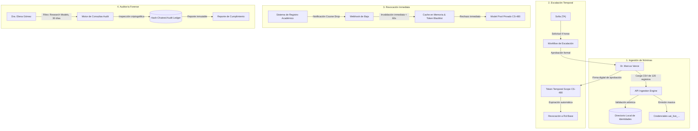
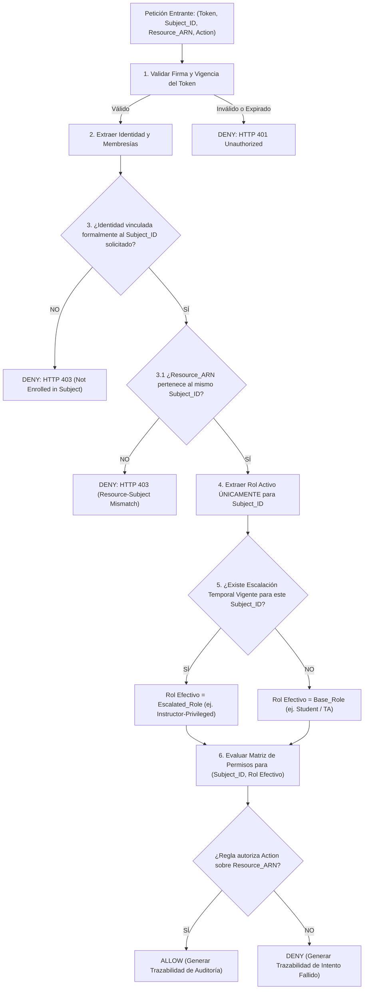

> **Copia de entrega (2026-10-14).** Copia de `../../planning/prd.md` (fuente Plan-2 actualizada por Solu-2) para que todo el paquete quede bajo `solu2-module1/`. Contenido idéntico salvo esta nota y las rutas relativas ajustadas.

---
title: "PRD — Módulo 1: User, Role, and Subject Access Manager"
module: "Módulo 1 — User, Role, and Subject Access Manager"
tier: "Foundation"
status: "draft"
version: "1.0.0"
created: "2026-09-23"
updated: "2026-09-23"
author: "John (BMad Product Manager)"
project: "Plataforma de Gestión de Cómputo IA de la Universidad"
---

# Product Requirements Document (PRD)
## Módulo 1: User, Role, and Subject Access Manager (Tier: Foundation)

---

## 1. Resumen Ejecutivo y Enunciado del Problema

### 1.1 Contexto Operativo
La Universidad opera una infraestructura heterogénea de aceleración local compuesta por:
- **31 Workstations departamentales:** Cada una con 1 GPU de 24 GB VRAM (clase RTX 4090 / 3090, 16–32 vCPUs, 64 GB RAM, 500 GB NVMe).
- **1 Servidor central de alto rendimiento:** Equipado con 2 GPUs de 48 GB VRAM cada una (clase RTX 6000 Ada / A40, 96 GB VRAM combinada, 64 vCPUs, 256 GB RAM, 4 TB NVMe).

Esta infraestructura debe dar soporte simultáneo a cientos de estudiantes de pregrado, asistentes de cátedra, docentes e investigadores en asignaturas con demandas de cómputo radicalmente dispares: desde *CS101* (ejercicios introductorios sin cuota de GPU o sólo inferencia mínima), pasando por *CS-480 Intro to Machine Learning* (fine-tuning liviano y visión computacional en workstations de 24 GB), hasta *NLP Advanced* y grupos de investigación doctoral (cómputo distribuido y modelos de 70B parámetros en el nodo central de 96 GB).

### 1.2 El Problema Central
Hasta la fecha, el aprovisionamiento de credenciales, tokens de API y accesos a nodos de cómputo se ha realizado mediante hojas de cálculo desconectadas, intercambio informal de llaves y scripts artesanales. Esta práctica genera:
1. **Fricción administrativa crítica:** El personal docente y administrativo pierde días al inicio de cada semestre vinculando manualmente a cientos de estudiantes a servicios locales.
2. **Brechas de seguridad institucional:** Credenciales huérfanas persisten activas tras cancelaciones de asignaturas (*course drops*), permitiendo el uso no autorizado de modelos privados y hardware escaso.
3. **Escalamiento caótico de privilegios:** Asistentes de docencia que requieren capacidades superiores para preparar laboratorios reciben accesos globales no acotados que comprometen la estabilidad del clúster.
4. **Opacidad forense:** Inexistencia de registros inmutables que permitan a un auditor verificar qué credencial accedió a pesos restringidos protegidos por acuerdos de licencia académica.

El **Módulo 1: User, Role, and Subject Access Manager** constituye el cimiento criptográfico e identitario (*Tier: Foundation*) de la plataforma. Su misión es encapsular el ciclo de vida de identidades académicas, roles contextuales y autorizaciones acotadas por asignatura (*Subject-Scoped RBAC/ABAC*), resolviendo consultas de autorización en milisegundos y gobernando la emisión, revocación y auditoría de credenciales simuladas sin requerir acoplamiento físico con el clúster.

---

## 2. Límites del Sistema y Alcance de Ingeniería

### 2.1 Propiedad Exclusiva del Módulo 1 (In-Scope)
El Módulo 1 es el dueño absoluto de las siguientes responsabilidades y estructuras de datos:
1. **Directorio Local de Identidades Académicas:** Almacenamiento y consulta de perfiles normalizados (identificador institucional, nombre, correo institucional, estado de matrícula).
2. **Motor de Asignación de Materias y Roles (Subject-Role Mapping):** Modelo relacional que vincula a cada individuo con una o más asignaturas bajo un rol específico (`Student`, `Teaching Assistant`, `Instructor`, `Auditor`, `System Admin`).
3. **Motor de Resolución de Permisos en Tiempo Real (Permission Resolution Engine):** Evaluación determinista de tuplas `(subject_id, role, resource_arn, action)` para responder consultas `ALLOW` o `DENY` con justificaciones estructuradas.
4. **Ciclo de Vida de Credenciales y Tokens de API Simulados:** Generación, hashing seguro (SHA-256), emisión de API keys prefijadas (`uai_live_...`), verificación de vigencia y revocación instantánea mediante listas de revocación en memoria.
5. **Registro Inmutable de Auditoría de Accesos:** Almacén transaccional de eventos de seguridad que preserva trazas criptográficamente verificables (timestamp ISO 8601 UTC, ID de sujeto, rol ejercido, recurso consultado, veredicto y hash encadenado).
6. **Portal Web Administrativo y RBAC API Explorer:** Interfaz gráfica ligera y consola Swagger/OpenAPI para la inspección interactiva y ejecución de fixtures de prueba.

### 2.2 Dependencias Mockeadas y Delegadas (Out-of-Scope para Módulo 1)
Para garantizar su operatividad *standalone* y desacoplamiento absoluto, el Módulo 1 delega y simula:
- **Telemetría y Estado de Hardware GPU:** Módulo 1 no lee temperaturas, VRAM ocupada ni estados de ventiladores. Asume como contrato externo la existencia de identificadores de recursos (ej. `node:ws-gpu-01:gpu0`, `tier:workstation-24gb`). Este monitoreo corresponde al *Módulo 3 (GPU Lab Digital Twin)*.
- **Planificación y Colocación en Kubernetes / K3s:** Módulo 1 no interactúa con el `kube-apiserver`, no crea `Pod`, ni orquesta `PyTorchJob`. Emite la decisión de autorización; la colocación física es responsabilidad de los módulos de scheduling.
- **Inferencia y Métricas de Tokens LLM:** Módulo 1 no sirve pesos de HuggingFace ni interactúa con endpoints de vLLM. Valida si la credencial tiene derecho a invocar el modelo `model:llama-3-8b-instruct:cs480`; el conteo de tokens de generación corresponde al *Módulo 5* y a la capa de Gateway.
- **Servidor Central LDAP/SSO de la Universidad:** Módulo 1 opera con un proveedor de identidad simulado (*Mock Identity Fixtures*) alimentado por archivos JSON/CSV deterministas que emulan el Active Directory institucional.

### 2.3 Non-Goals Explícitos
- **NO** implementará un portal de chat para estudiantes ni un playground de completado de prompts.
- **NO** particionará físicamente memoria VRAM (MIG o vGPU) en los controladores NVIDIA.
- **NO** gestionará pagos, subsidios monetarios ni transferencias financieras de cuotas.
- **NO** sincronizará en tiempo real con pasarelas de red perimetral universitaria (firewalls o VPNs institucionales).

---

## 3. Protagonistas Nombrados y Modelos de Interacción

Queda terminantemente prohibido el uso del término abstracto "el usuario". Cada flujo es ejecutado o experimentado por un protagonista académico específico:

### 3.1 Dr. Marcus Vance — Director de Departamento de CS y Administrador de la Plataforma
- **Perfil:** Lidera el Departamento de Ciencias de la Computación. Vela por la equidad en el uso del clúster, el cumplimiento de los contratos de licencia de modelos y la prevención de saturación de infraestructura.
- **Responsabilidad en Módulo 1:** Cargar nóminas semestrales masivas, configurar directivas de asignaturas, autorizar solicitudes de escalación de privilegios sensibles y auditar accesos ante comités de investigación.
- **Dolor principal:** Pasar noches resolviendo problemas de permisos por correos o descubriendo que estudiantes de semestres anteriores continúan consumiendo instancias de cómputo.

### 3.2 Sofia — Asistente de Cátedra (TA) para *Introduction to Machine Learning (CS-480)*
- **Perfil:** Estudiante de maestría. Diseña los laboratorios prácticos de *CS-480*, supervisa a 120 alumnos y paralelamente toma como estudiante regular la materia *NLP Advanced*.
- **Responsabilidad en Módulo 1:** Gestionar llaves de prueba para laboratorios, solicitar elevación temporal de privilegios para afinar checkpoints de modelos docentes antes de las sesiones prácticas.
- **Dolor principal:** Quedar bloqueada con permisos regulares de estudiante cuando debe compilar y validar tareas docentes complejas, o tener que esperar días por la aprobación de un ticket manual.

### 3.3 Mateo — Estudiante de Pregrado (Matrícula Simultánea)
- **Perfil:** Estudiante de tercer año. Cursa simultáneamente *CS101* (programación básica sin acceso a GPU) y *CS-480* (Intro to ML con acceso regulado a modelos en workstations de 24 GB).
- **Responsabilidad en Módulo 1:** Poseer una credencial única que le otorgue acceso estricto a las herramientas de *CS-480* sin poder utilizar recursos de GPU bajo el contexto de *CS101*.
- **Dolor principal:** Confusión de cuotas y bloqueos indebidos causados por la mezcla de sus dos estados académicos en una sola cuenta institucional.

### 3.4 Dra. Elena Gómez — Auditora de Cumplimiento de Investigación Académica
- **Perfil:** Miembro del comité de ética y cumplimiento computacional de la Universidad. No administra servidores ni dicta clases.
- **Responsabilidad en Módulo 1:** Ejecutar inspecciones periódicas e imprevistas sobre el uso de modelos propietarios o restringidos (ej. modelos médicos o con licencias comerciales cerradas) en ventanas de 30 a 90 días.
- **Dolor principal:** Falta de reportes confiables; registros de acceso alterables o logs saturados de datos innecesarios donde es imposible trazar el uso exacto de un recurso sensible.

---

## 4. Escenarios Obligatorios y Requisitos Funcionales (FRs)



---

### 4.1 Escenario Obligatorio 1: Carga Masiva de Nómina Semestral (Course Roster Ingestion)

#### `FR-INGEST-01`: Ingestión Atómica de Nóminas de Asignatura
- **Responsabilidad:** El sistema debe importar, validar y persistir listas masivas de matriculados vinculando identidades institucionales a una asignatura y período lectivo específico, generando o actualizando sus registros RBAC y aprovisionando credenciales preconfiguradas sin intervención manual.
- **Disparador (Trigger):** El Dr. Marcus Vance carga un archivo CSV o payload JSON a través del Web Admin Portal o ejecuta el endpoint `POST /api/v1/subjects/{subject_id}/roster`.
- **Entradas:**
  - `subject_id`: Identificador canónico de la materia (ej. `CS-480`).
  - `term`: Período académico (ej. `2026-FALL`).
  - `roster_payload`: Lista de 120 registros que contienen para cada estudiante: `institutional_id` (string alfanumérico, ej. `STU-98432`), `email` institucional (`@universidad.edu`), `full_name`, y `assigned_role` (por defecto `Student`).
- **Reglas de Validación:**
  1. Cada registro debe poseer un formato de correo válido perteneciente estrictamente al dominio `@universidad.edu`.
  2. El `subject_id` debe existir previamente en el catálogo de materias activas del semestre.
  3. Integridad referencial y estado disciplinario: Si un estudiante ya existe en la base global por otra asignatura, no se duplica la identidad; únicamente se asocia el nuevo vínculo `(student_id, subject_id, role, term)`. Si la identidad preexistente posee estado institucional `SUSPENDED` o `EXPELLED`, la vinculación es rechazada inmediatamente y el registro se deriva al manifiesto de cuarentena (`roster_rejected_conflicts.csv`).
  4. Procesamiento transaccional de lote (*Batch Transaction*): La operación es atómica por lote. Si el archivo presenta corrupción sintáctica o campos requeridos nulos, se rechaza la transacción completa sin escrituras parciales.
- **Salidas:**
  - Código HTTP `201 Created` con resumen cuantitativo: `{ "processed": 120, "created_identities": 115, "updated_memberships": 5, "batch_id": "roster-b89f-2026" }`.
  - Emisión de credenciales sintéticas prefijadas `uai_live_<hash_aleatorio_32_bytes>` listas para su entrega segura.
  - Evento de auditoría emitido con el ID de ejecución del Dr. Marcus Vance.
- **Condición de Prueba Unitaria / E2E:**
  - *Prueba E2E:* Cargar un archivo fixture simulado con exactamente 120 estudiantes para la materia `CS-480`. El test verifica que la base de datos registra 120 membresías activas bajo `CS-480`, 120 hashes de credenciales generadas y un tiempo total de procesamiento en base de datos menor a 2.0 segundos.
  - *Prueba de fallo:* Cargar un lote de 120 donde la fila 85 contenga un correo externo (`@gmail.com`). La prueba debe certificar que la transacción realiza rollback completo, retornando `HTTP 422 Unprocessable Entity` con el detalle del error en la fila 85, dejando la base de datos con 0 registros creados del lote.

---

### 4.2 Escenario Obligatorio 2: Solicitud y Escalación Temporal de Privilegios (Privilege Escalation Request)

#### `FR-ESCAL-02`: Gestión de Escalación Temporal de Privilegios con Ventana Acotada
- **Responsabilidad:** Permitir que personal docente auxiliar solicite y reciba de manera controlada un rol temporal elevado circunscrito a su materia para labores de cómputo intensivo, garantizando expiración estricta sin residuo de permisos.
- **Disparador (Trigger):** Sofia (TA de *CS-480*) envía una solicitud formal de escalación mediante `POST /api/v1/escalations/request` solicitando el rol `Instructor-Privileged`.
- **Entradas:**
  - `requester_id`: Identificador de Sofia (`TA-SOFIA-01`).
  - `subject_id`: `CS-480`.
  - `requested_role`: `Instructor-Privileged` (habilita acceso a colas de entrenamiento en workstations y servidor central).
  - `duration_hours`: Entero positivo (ej. `4` horas; tope máximo configurable de 12 horas).
  - `justification`: Texto mandatorio justificando la necesidad pedagógica (mínimo 20 caracteres, ej. `"Pre-entrenamiento de checkpoints para laboratorio de Vision Transformers"`).
- **Reglas de Validación:**
  1. Sofia debe poseer un rol base activo de `Teaching Assistant` en la materia indicada (`CS-480`).
  2. No se admiten solicitudes auto-aprobadas. El estado inicial debe ser invariablemente `PENDING_APPROVAL`.
  3. Aprobación obligatoria por el administrador departamental (Dr. Marcus Vance).
  4. Control de concurrencia y no-solapamiento: Se rechaza cualquier solicitud adicional si la identidad ya posee una escalación en estado `PENDING` o `ACTIVE` para la misma materia (`HTTP 409 Conflict: CONCURRENT_ESCALATION_NOT_PERMITTED`), previniendo extensiones infinitas o saturación de solicitudes.
  5. Límite de vigencia: Al expirar el tiempo concedido (`grant_timestamp + duration_hours`), el sistema revoca automáticamente la elevación a través de un scheduler interno sin necesidad de intervención humana.
  6. Acotamiento estricto de contexto: La elevación aplica *únicamente* sobre acciones y modelos de la materia `CS-480`. No incrementa privilegios en materias donde Sofia sea estudiante regular (como *NLP Advanced*).
- **Salidas:**
  - Creación del ticket de escalación `ESC-2026-480-01` en estado `PENDING`.
  - Tras la acción de aprobación por el Dr. Marcus Vance (`POST /api/v1/escalations/ESC-2026-480-01/approve`): generación de un Bearer Token efímero con claim de expiración (`exp`) y scope restringido `urn:uai:subject:cs-480:instructor_privileged`.
- **Condición de Prueba Unitaria / E2E:**
  - *Prueba Unitaria:* Simular el avance del reloj del sistema (*freezegun / time travel*) en 4 horas y 1 segundo tras la aprobación. Una invocación de verificación de permisos con la credencial de Sofia debe retornar `DENY` inmediato para acciones de entrenamiento privilegiadas, restableciendo el rol a `Teaching Assistant` estándar.
  - *Prueba de fallo (Intento no autorizado):* Sofia intenta llamar al endpoint `/approve` con su propio token. El sistema debe responder `HTTP 403 Forbidden`, bloquear la solicitud y registrar el incidente en el log de auditoría como violación de integridad de privilegios.

---

### 4.3 Escenario Obligatorio 3: Revocación Inmediata por Cancelación de Materia (Revocation upon Course Drop)

#### `FR-REVOC-03`: Revocación Sub-Minuto de Credenciales por Baja Académica
- **Responsabilidad:** Revocar de inmediato el acceso a los pools de modelos privados y hardware asignados a una asignatura cuando un estudiante cancela su matrícula académica, invalidando tokens activos en la capa de autorización en un lapso inferior a 60 segundos.
- **Disparador (Trigger):** Notificación de baja emitida vía API administrativa o webhook simulado del sistema de registro: `POST /api/v1/subjects/{subject_id}/enrollments/{student_id}/drop`.
- **Entradas:**
  - `student_id`: Identificador de Mateo (`STU-MATEO-99`).
  - `subject_id`: `CS-480`.
  - `drop_reason`: Cadena informativa (ej. `"Estudiante retiró la asignatura formalmente"`).
  - `timestamp`: Timestamp ISO 8601 de la transacción académica.
- **Reglas de Validación:**
  1. El estudiante debe estar formalmente registrado con matrícula activa en `CS-480`.
  2. Transición de estado y persistencia de credencial: La membresía cambia de `ACTIVE` a `DROPPED` en el almacén de datos transaccional. Para llaves de API estáticas (`uai_live_...`), el registro en la tabla relacional `subject_credentials` pasa inmediatamente a estado `REVOKED`.
  3. Inyección en lista de revocación en memoria (Revocation Cache / Version Bump): La tupla `(student_id, subject_id)` y el hash de la credencial se agregan al conjunto en memoria de llaves revocadas (`revoked_credentials_cache`) en $< 200\text{ ms}$, forzando la invalidación determinista de cualquier sesión o token en caché.
  4. Preservación de membresías no afectadas: Si Mateo continúa inscrito en otra materia (ej. *CS101*), sus credenciales para dicha materia deben permanecer operativas sin verse alteradas.
- **Salidas:**
  - Código HTTP `200 OK` con confirmación de desvinculación: `{ "student_id": "STU-MATEO-99", "subject_id": "CS-480", "status": "REVOKED", "revocation_propagated_at": "2026-09-23T15:04:05.120Z" }`.
  - Rechazo instantáneo (`HTTP 401 Unauthorized / HTTP 403 Forbidden`) en cualquier solicitud entrante con credenciales de Mateo dirigida al pool de modelos de `CS-480`.
  - Trazabilidad: Emisión de evento al log de auditoría con la marca de tiempo exacta de revocación.
- **Condición de Prueba Unitaria / E2E:**
  - *Prueba E2E de latencia de corte:* Se emite un drop para Mateo en `CS-480`. Dentro de una ventana de prueba de 5 segundos (bien por debajo del límite de 60s), se realiza una petición sintética `POST /api/v1/authorize` intentando acceder a `model:llama-3-vision-private:cs-480`. La respuesta debe ser determinista: `result: DENY`, código `SUBJECT_ENROLLMENT_DROPPED`, con tiempo de propagación registrado menor a 500 ms.

---

### 4.4 Escenario Obligatorio 4: Consulta Forense y Auditoría de Cumplimiento (Audit Query)

#### `FR-AUDIT-04`: Trazabilidad Forense e Inspección Criptográfica de Accesos
- **Responsabilidad:** Permitir que auditores autorizados inspeccionen el historial de autorizaciones y consultas sobre modelos restringidos en un rango temporal definido, garantizando inmutabilidad y respuesta determinista de eventos.
- **Disparador (Trigger):** La Dra. Elena Gómez (Auditora) ejecuta una consulta a través del Admin Portal o vía `GET /api/v1/audit/access-events`.
- **Entradas:**
  - `filter_resource_type`: `model:restricted:research` (filtro por clase de recurso protegido).
  - `time_range_start`: Timestamp ISO 8601 (ej. `now - 30 days`).
  - `time_range_end`: Timestamp ISO 8601 (ej. `now`).
  - `verdict_filter`: Opcional (`ALL`, `ALLOW`, `DENY`).
  - `page_size`, `cursor`: Parámetros de paginación determinista.
- **Reglas de Validación:**
  1. Verificación de identidad: La Dra. Elena Gómez debe contar con el rol institucional `Auditor` verificado en su token de llamada.
  2. Rango acotado y límite de paginación: La ventana máxima de consulta síncrona es de 90 días naturales. El parámetro `page_size` debe ser un entero entre 1 y 100 (por defecto 50); solicitudes con `page_size > 100` son truncadas automáticamente a 100 para proteger la memoria RAM del servicio.
  3. No repudio y sanitización: Los eventos retornados deben contener la firma hash encadenada (`prev_record_hash -> current_record_hash`) y **cero** llaves privadas o credenciales en texto claro (únicamente prefijos seguros, ej. `uai_live_8f3a...`).
- **Salidas:**
  - Código HTTP `200 OK` retornando una lista estructurada de eventos:
    ```json
    {
      "total_records": 142,
      "query_window_days": 30,
      "page_size": 50,
      "events": [
        {
          "event_id": "evt-7712-bc9",
          "timestamp": "2026-09-12T10:14:22.004Z",
          "actor_id": "STU-98432",
          "actor_role": "Student",
          "subject_id": "CS-480",
          "resource_arn": "urn:uai:subject:cs-480:model:restricted:biomed-llm-70b",
          "decision": "DENY",
          "reason_code": "UNAUTHORIZED_RESOURCE_CLASS",
          "record_hash": "e3b0c44298fc1c149afbf4c8996fb92427ae41e4649b934ca495991b7852b855"
        }
      ]
    }
    ```
- **Condición de Prueba Unitaria / E2E:**
  - *Prueba de integridad:* Inyectar 1,000 eventos de prueba en el ledger de auditoría y verificar la cadena de hashes SHA-256 entre registros consecutivos. Cualquier intento de alteración manual de un registro intermedio debe romper la verificación con error `AUDIT_LOG_TAMPERING_DETECTED`.
  - *Prueba de consulta:* Ejecutar la consulta del filtro de 30 días contra un dataset de 50,000 eventos históricos. El tiempo de respuesta total debe situarse por debajo de 200 ms ($p95$).

---

## 5. Caso de Borde Obligatorio: Membresía Simultánea Multi-Materia con Políticas en Conflicto

### 5.1 Enunciado del Conflicto de Autorización
Un estudiante o asistente puede estar matriculado en varias materias concurrentemente con prerrogativas diametralmente opuestas:
- **Caso Real:** Mateo cursa *CS101* (donde la política institucional estipula **cero acceso a GPU** y sólo inferencia de modelos juguete en CPU) y al mismo tiempo cursa *CS-480* (donde tiene rol `Student` con acceso a modelos de 8B en workstations de 24 GB).
- **Caso Crítico de Asistente:** Sofia cursa *NLP Advanced* como estudiante regular (sin privilegios de entrenamiento) y es `Teaching Assistant` en *CS-480* (con privilegios de escalación y despliegue prioritario de modelos docentes).

Si el sistema evaluara privilegios mediante una agregación global plana (ej. `Union(roles)`), Mateo o Sofia acumularían privilegios de forma indebida, permitiendo que Mateo ejecute cargas de *CS-480* bajo el contexto de *CS101*, o que Sofia reserve instancias de alta prioridad en su clase de posgrado abusando de su rol de asistente en otra cátedra.

### 5.2 Algoritmo de Aislamiento y Resolución de Contexto (Context-Enforced RBAC)



#### Reglas Inviolables del Algoritmo:
1. **Context Isolation (Aislamiento de Asignatura):** Toda consulta de acceso debe declarar explícitamente el encabezado `X-Academic-Subject-Context: <subject_id>`. La resolución de rol se ejecuta **únicamente** sobre la tupla `(identity_id, subject_id)`.
2. **Resource-Subject Binding (Defensa Confused Deputy):** El motor valida obligatoriamente que el `Resource_ARN` consultado pertenezca a la misma asignatura especificada en el contexto (`resource.subject_id == context.subject_id`). Se rechaza con `HTTP 403 RESOURCE_SUBJECT_MISMATCH` cualquier intento de invocar recursos de una asignatura (ej. *NLP Advanced*) bajo el contexto de otra (ej. *CS-480*), aun cuando la identidad posea rol de TA o Instructor en esta última.
3. **Prohibición de Herencia Cruzada:** Los permisos de una materia jamás se mezclan en tiempo de ejecución. El rol `Teaching Assistant` en *CS-480* tiene impacto nulo ($0$) sobre las evaluaciones en *CS101* o *NLP Advanced*.
4. **Principio de Mínimo Privilegio por Defecto:** Si una petición no incluye contexto de materia, o si la identidad no está activa en la materia especificada, la resolución es deterministamente `DENY` con código `SUBJECT_CONTEXT_MISSING_OR_UNAUTHORIZED`.

---

## 6. Requisitos No Funcionales (NFRs) con Tolerancias Numéricas

Quedan proscritos los adjetivos elásticos (*rápido, eficiente, escalable, seguro, robusto*). Los siguientes criterios son contratos matemáticos estrictos:

| ID | Dimensión | Métrica Numérica / Límite Aceptable | Método de Medición / Verificación |
| :--- | :--- | :--- | :--- |
| **NFR-PERF-01** | Latencia de Decisión RBAC | $\text{Latencia } p95 < 20\text{ ms}$; $\text{Latencia } p99 < 50\text{ ms}$ bajo carga sostenida de $100\text{ req/s}$. | Prueba de estrés con k6/Locust durante 5 minutos contra `/api/v1/authorize`. |
| **NFR-PERF-02** | Rendimiento Ingestión Roster | Procesamiento y persistencia de lote de $1,000\text{ registros}$ en tiempo total $T < 3.0\text{ s}$. | Benchmark de carga con payload sintético de nómina universitaria. |
| **NFR-REVOC-03** | Tiempo de Revocación de Acceso | Invalidación determinista en memoria local en $T_{local} < 200\text{ ms}$; propagación y corte en proxies perimetrales con caché HTTP en $T_{revoc} < 60\text{ s}$ (TTL máximo de caché de clientes = 60s). | Test E2E de revocación disparando petición inmediata al segundo 1, 5 y 30 post-drop. |
| **NFR-SEC-04** | Fuga de Secretos en Trazas | **Exactamente 0** llaves de API o tokens completos en texto plano en logs (`stdout`, `stderr`), respuestas de error o tablas de auditoría. | Script de análisis estático y escaneo de expresiones regulares (`uai_live_[a-zA-Z0-9]{32}`) sobre 10,000 líneas de log generadas en test. |
| **NFR-SEC-05** | Almacenamiento Criptográfico de Credenciales | Todas las llaves de API se almacenan hasheadas con SHA-256 y salt de 16 bytes. El valor crudo se muestra **una sola vez** al momento de emisión. | Inspección de esquema y aserción de base de datos en tests unitarios de creación de credenciales. |
| **NFR-AUDIT-06** | Rendimiento de Consulta Forense | Consulta sobre ventana de 30 días con $100,000\text{ eventos}$ indexados responde en $T < 500\text{ ms}$ ($p95$). | Benchmark SQL/B-Tree sobre índice compuesto `(resource_type, timestamp)`. |
| **NFR-DISP-07** | Huella Operativa Standalone | Consumo máximo de memoria RAM $\le 512\text{ MB}$; inicio en frío del contenedor Docker Compose en tiempo $T_{boot} < 5.0\text{ s}$. | `docker stats` y healthcheck en pipeline de integración continua. |

---

## 7. Modelo de Fallos y Resiliencia Defensiva

### 7.1 Gestión de Intentos de Escalación No Autorizados
- **Vector de Amenaza 1 (Auto-Aprobación / Manipulación de Solicitud):**
  - *Mecanismo Defensivo:* El endpoint `/escalations/{id}/approve` exige autenticación criptográfica que valide pertenencia al rol `System Admin` o `CS Department Chair` (Dr. Marcus Vance). Si un solicitante regular intenta auto-aprobar su solicitud, el motor intercepta la llamada, genera `HTTP 403 Forbidden` estructurado bajo RFC-7807:
    ```json
    {
      "type": "https://compute.universidad.edu/errors/forbidden-escalation-approval",
      "title": "Forbidden Privilege Self-Approval",
      "status": 403,
      "detail": "Identity TA-SOFIA-01 does not possess administrative entitlement to approve escalation ESC-2026-480-01.",
      "instance": "/api/v1/escalations/ESC-2026-480-01/approve"
    }
    ```
  - *Mitigación Forense:* Registro inmediato del incidente en el log de auditoría con severidad `SECURITY_ALERT` y bloqueo preventivo de nuevas solicitudes de escalación durante 1 hora para ese solicitante.

- **Vector de Amenaza 2 (Expiración Ignorada por Proceso Colgado):**
  - *Mecanismo Defensivo:* Los tokens temporales emitidos incluyen en su cuerpo criptográfico (`payload`) la fecha de expiración `exp`. El evaluador de políticas rechaza el token a nivel de firma matemática si `now() >= exp`, imposibilitando que un proceso continúe operando aun cuando el worker asíncrono de revocación en base de datos sufra un retraso transitorio.

### 7.2 Gestión de Colisiones de Identidad e Integridad en Importaciones Masivas
- **Colisión Tipo A (Duplicidad de ID Institucional con Metadatos Divergentes):**
  - *Escenario:* El CSV importado por el Dr. Marcus Vance contiene un registro con `STU-98432` a nombre de `"Mateo Gómez"`, pero en la base de datos central ese mismo ID ya pertenece a `"Mateo Silva"`.
  - *Comportamiento:* Aislamiento de fila y activación de política de *Quarantine List*. El sistema aborta la ingestión si la bandera de operación es `STRICT` o segrega los registros con colisión en un archivo de salida `roster_rejected_conflicts.csv` detallando: número de fila, valor en base de datos vs. valor en archivo. Ningún dato preexistente es sobrescrito de forma silenciosa.

- **Colisión Tipo B (Doble Inscripción en Mismo Archivo):**
  - *Escenario:* El archivo de 120 alumnos lista dos veces al mismo estudiante con roles en pugna (ej. fila 12: `Student`; fila 45: `Teaching Assistant`).
  - *Comportamiento:* Rechazo automático del lote con código `HTTP 422 Unprocessable Entity` y mensaje declarativo: `"Roster integrity violation: Duplicate student_id STU-98432 detected in rows 12 and 45 with conflicting roles."`.

### 7.3 Degradación y Pérdida de Conectividad con el Almacén de Políticas
- En caso de inyección de fallas o corrupción temporal en el almacenamiento SQLite/PostgreSQL local, el motor de autorización asume una postura de seguridad estricta: **Fail-Closed (Denegación por Defecto)**. Ante cualquier excepción interna de base de datos no recuperada, la respuesta es deterministamente `DENY` con código de error `AUTH_INTERNAL_POLICY_UNAVAILABLE` y código HTTP 503.

---

## 8. Especificación del Prototipo Standalone

### 8.1 Alcance del Prototipo Ejecutable
El Módulo 1 se materializará como un artefacto independiente y verificable en un contenedor Docker individual, compuesto por:
1. **Backend de Servicio (FastAPI / Node.js TypeScript):**
   - Implementa los endpoints RESTful para Roster Ingestion, Escalation Workflow, Token Lifecycle, Audit Query y Policy Evaluation.
   - Base de datos local transaccional (SQLite en modo WAL / PostgreSQL embebido) inicializada con fixtures representativos de la Universidad.
2. **Web Admin Portal & RBAC API Explorer:**
   - Interfaz web interactiva construida con UI reactiva liviana que permite visualizar gráficamente a las identidades, los cursos (`CS101`, `CS-480`, `NLP Advanced`), el estado de las credenciales y el visualizador en vivo del log de auditoría.
   - Swagger / OpenAPI Explorer interactivo con botones de ejecución preconfigurados para simular los 4 escenarios obligatorios.
3. **Fixtures Simulados de Identidad (Seed Data):**
   - Nómina pre-cargada con los perfiles del Dr. Marcus Vance, Sofia, Mateo y 120 identidades estudiantiles sintéticas con estados de curso activos y suspendidos.

---

## 9. Preguntas Abiertas y Supuestos Asumidos

### 9.1 Supuestos Asumidos `[ASSUMPTION]`
1. `[ASSUMPTION-01]`: Las cuotas de consumo por materia (ej. límite de 100 horas/mes de GPU o cuotas de tokens) no son calculadas por el Módulo 1, sino por el *Módulo 2 (GPU Policy Engine)* y el *Módulo 8 (Token Quota Accounting)*. El Módulo 1 responde exclusivamente sobre derechos de rol y asignatura (`ALLOW`/`DENY` basado en rol e inscripción).
2. `[ASSUMPTION-02]`: El formato de credencial simulada emitido (`uai_live_...`) no requiere verificación de clave pública asimétrica externa; se valida contra el hash local SHA-256 y la lista de revocación en memoria.
3. `[ASSUMPTION-03]`: Los cursos académicos siguen un ciclo semestral cerrado. Las membresías no renovadas en el período subsiguiente quedan marcadas como `INACTIVE` automáticamente tras la fecha límite del semestre.

### 9.2 Preguntas Abiertas para Validación de Stakeholders
1. *¿Cuál es el procedimiento exacto ante una solicitud de revocación retroactiva por fraude académico?* (Pendiente de definir con el Dr. Marcus Vance si se debe invalidar retroactivamente la validez de los hashes de auditoría previa o si se mantiene la inmutabilidad histórica registrando un evento compensatorio).
2. *¿Se debe permitir a los profesores titulares (Instructors) aprobar escalaciones temporales para sus propios TAs sin intervención directa del Dr. Marcus Vance?* (Actualmente el PRD exige firma del Department Chair para garantizar control presupuestal de la flota).
