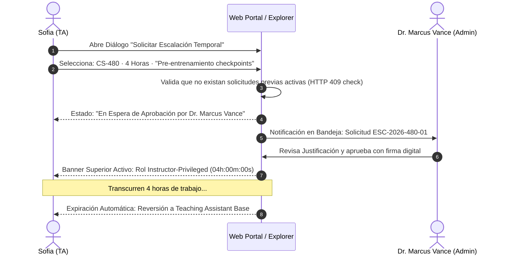

# Escenario 2: Solicitud y Escalación Temporal de Privilegios

---

## [C] Conceptualize (Conceptualización)

### 1. Intención de los Protagonistas y Dinámica Colaborativa
- **Sofia (TA de CS-480):** Necesita afinar un modelo docente en las workstations de 24 GB y validar un checkpoint en el servidor central de 96 GB antes del laboratorio de mañana. Su rol base de TA no le permite lanzar entrenamiento intensivo. Necesita elevar su rol temporalmente a `Instructor-Privileged` por 4 horas sin burocracia opaca.
- **Dr. Marcus Vance (Admin):** Debe garantizar que la flota no sea acaparada. Requiere conocer el motivo pedagógico exacto, el tiempo solicitado y firmar la autorización con un solo clic desde su consola departamental.
- **Principio WDS:** *Claridad de Vigencia y Aislamiento de Materia*. La interfaz de Sofia debe reflejar visiblemente el estado de su ticket y, una vez aprobado, exhibir un temporizador dinámico que indique el tiempo restante exacto, garantizando que sus privilegios elevados aplican exclusivamente para *CS-480*.

### 2. Flujo de Interacción de Dos Vías

---

## [P] Write Specifications (Especificaciones Detalladas)

### 1. Componentes de Interfaz y Estados Visuales

#### Componente 1: Diálogo de Solicitud de Sofia (`#escalation-request-dialog`)
- **Campos del Formulario:**
  1. *Asignatura:* Dropdown deshabilitado fijado en `CS-480 (Intro to Machine Learning)` (contexto de TA activo).
  2. *Rol Solicitado:* Badge selector pre-fijado en `Instructor-Privileged`.
  3. *Duración:* Slider interactivo de $1$ a $12$ horas (valor por defecto: `4 horas`).
  4. *Justificación Pedagógica:* Área de texto (`textarea`) con contador dinámico de caracteres: `Mínimo 20 caracteres (Actual: 64)`.
- **Botón de Envío:** `[ Enviar Solicitud a Jefatura ]` (Token `--brand-primary`).

#### Componente 2: Tarjeta de Aprobación en Bandeja de Marcus Vance (`#admin-escalation-card`)
- **Ubicación:** Pestaña "Escalaciones" en el panel del Dr. Marcus Vance.
- **Elementos Visuales:**
  - Badge de estado: `[ ⚡ PENDING APPROVAL ]` (Fondo `--status-pending-bg`, borde `--status-pending-border`).
  - Información contextual: `Solicitante: Sofia (TA-SOFIA-01) · Materia: CS-480 · Duración: 4h`.
  - Justificación citada: *"Pre-entrenamiento de checkpoints para laboratorio de Vision Transformers."*
  - Botones de acción: `[ ✔ Aprobar Escalación ]` (Verde Esmeralda) y `[ ✖ Denegar con Motivo ]` (Rojo Carmesí).

#### Componente 3: Banner de Sesión Activa con Temporizador (`#active-escalation-banner`)
- **Ubicación:** Barra superior del portal de Sofia, anclada durante toda la sesión.
- **Tokens:** Borde inferior `--status-pending-border`, fondo `--status-pending-bg`.
- **Contenido Dinámico:**
  - Icono de rayo pulsante.
  - Texto: `Rol Temporal Activo: Instructor-Privileged (CS-480) · Expira en:`
  - Reloj en monospace: `03h : 42m : 18s` (actualizado cada segundo vía JavaScript local).
  - Botón de terminación temprana: `[ Liberar Privilegios Anticipadamente ]`.

#### Componente 4: Banner de Notificación de Rechazo para Sofia (`#escalation-denied-banner` — `EDGE-UX-02`)
- **Semántica:** Borde y fondo `--status-blocked-border`, `--status-blocked-bg`.
- **Despliegue:** Renderiza el `Banner E-04` si el Dr. Marcus Vance rechaza la solicitud, detallando la justificación textual del administrador, el timestamp de denegación y el período de enfriamiento de 30 minutos antes de poder emitir una nueva solicitud para esa misma ventana horaria.

---

## [V] Validate (Validación y Casos de Borde)

### 1. Detección de Intentos de Auto-Aprobación
- Si Sofia intenta consumir el endpoint `/escalations/{id}/approve` utilizando su propio Bearer Token:
  - La interfaz intercepta el código `HTTP 403 Forbidden` y renderiza el modal RFC-7807 indicando la falta de facultades de Chair.
  - El sistema bloquea nuevos intentos y genera un evento de alerta en el ledger de auditoría.

### 2. Prueba de Reversión Automática (Time-Travel Test)
- Al llegar el reloj a `00h:00m:00s`:
  - El banner cambia de estado instantáneamente a azul neutro (`--status-readonly-bg`).
  - Muestra la notificación: *"La ventana de escalación de 4 horas ha concluido. Sus permisos han retornado a Teaching Assistant. Los jobs activos mantendrán su prioridad de cola asignada al inicio."*

### 3. Prueba de Denegación Formal por Jefatura (`EDGE-UX-02`)
- El Dr. Marcus Vance introduce el motivo: `"Workstations reservadas para examen final de CS101"` y presiona `[ ✖ Denegar con Motivo ]`.
- Sofia recibe en tiempo real el `Banner E-04` en su panel, con su rol inalterado como TA y el formulario bloqueado para ese intervalo horario durante 30 minutos.
