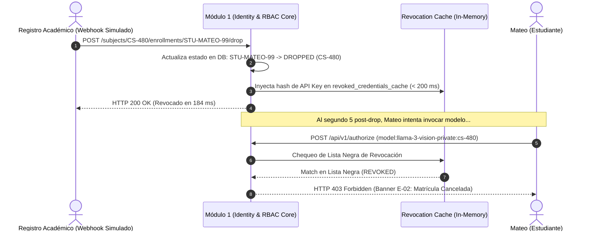

# Escenario 3: Revocación Automatizada tras Cancelación de Materia

---

## [C] Conceptualize (Conceptualización)

### 1. Intención del Protagonista y Dinámica del Evento
- **Protagonista:** Mateo, estudiante de pregrado que cursa simultáneamente *CS101* y *CS-480*.
- **Evento Académico:** Mateo decide cancelar su inscripción formal en *CS-480* ante la oficina de registro estudiantil.
- **Expectativa Institucional:** El sistema no puede depender de que un administrador recuerde eliminar las credenciales de Mateo. En menos de 60 segundos (objetivo interno en memoria $< 200\text{ ms}$), todo acceso de Mateo al pool de modelos privados de *CS-480* debe quedar permanentemente revocado, **sin afectar en lo absoluto su matrícula activa y accesos regulares en CS101**.
- **Estado Psicológico de Mateo:** Si intenta ejecutar un script en su notebook con su token anterior, no debe encontrarse con un error de red incomprensible ni con un mensaje genérico. La respuesta debe explicar claramente que su acceso a esa materia cesó por cancelación de matrícula.

### 2. Flujo de Transición y Propagación


---

## [P] Write Specifications (Especificaciones Detalladas)

### 1. Componentes de Interfaz y Estados Visuales

#### Componente 1: Fila de la Tabla de Membresías (`#member-row-mateo`)
- **Estado Previo al Drop:**
  - Identificador: `STU-MATEO-99 · Mateo Silva`
  - Materia: `CS-480`
  - Rol: `Student`
  - Badge de Estado: `[ ✔ ACTIVE ]` (Fondo verde `--status-active-bg`, texto `--status-active-text`).
- **Transición Visual Post-Drop:**
  - Micro-animación de transición de color (CSS transition 300ms).
  - Badge de Estado cambia a: `[ ✖ DROPPED / REVOKED ]` (Fondo rojo `--status-blocked-bg`, borde `--status-blocked-border`, texto `--status-blocked-text`).
  - Marca de tiempo de revocación: `--font-size-xs` en `--text-muted`: `Revocado: Hoy a las 15:04:05 (184ms)`.

#### Componente 2: Consola del Webhook Simulado (`#webhook-drop-tester`)
- **Ubicación:** Pestaña de Mocks en el RBAC API Explorer.
- **Acción Rápida de Prueba:** Botón `[ ⚡ Simular Drop de Mateo en CS-480 ]`.
- **Panel de Salida:** Muestra el payload emitido por el sistema institucional y el tiempo de respuesta:
  ```json
  {
    "event": "COURSE_ENROLLMENT_DROPPED",
    "student_id": "STU-MATEO-99",
    "subject_id": "CS-480",
    "db_transition_ms": 24,
    "cache_invalidation_ms": 2,
    "total_propagation_ms": 26,
    "sla_compliance": "PASS (< 60s)"
  }
  ```

#### Componente 3: Banner de Explicabilidad en Cliente (`#explainability-banner-dropped`)
- **Semántica:** Borde y acento rojo carmesí (`--status-blocked-border`).
- **Encabezado:** `Acceso Denegado: Matrícula Cancelada en CS-480 (HTTP 403)`
- **Cuerpo:** *"La matrícula de Mateo Silva en CS-480 fue dada de baja formalmente. El acceso a los pesos y modelos privados de esta materia ha sido revocado. Sus credenciales para CS101 continúan activas y sin restricciones."*

---

## [V] Validate (Validación y Casos de Borde)

### 1. Prueba de Doble Contexto (Aislamiento de Impacto)
- **Prueba 1 (Materia Cancelada):** Mateo envía petición a `urn:uai:subject:cs-480:model:llama-3-8b` con header `X-Academic-Subject-Context: CS-480`.  
  *Resultado Esperado:* `DENY` determinista con código `SUBJECT_ENROLLMENT_DROPPED`.
- **Prueba 2 (Materia Preservada):** Mateo envía petición a `urn:uai:subject:cs101:model:tiny-py-eval` con header `X-Academic-Subject-Context: CS101`.  
  *Resultado Esperado:* `ALLOW` determinista, verificando que la revocación fue estrictamente acotada a la asignatura cancelada.

### 2. Cumplimiento del SLA Numérico
- La revocación en el almacén en memoria local debe certificarse en **menos de 200 ms** en pruebas unitarias automatizadas.
