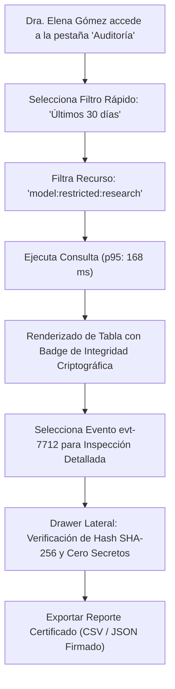

# Escenario 4: Consulta Forense y Auditoría de Cumplimiento

---

## [C] Conceptualize (Conceptualización)

### 1. Intención del Protagonista y Contexto Forense
- **Protagonista:** Dra. Elena Gómez (Auditora de Cumplimiento de Investigación Académica), acompañada por el Dr. Marcus Vance.
- **Objetivo Primario:** Realizar una auditoría formal sobre el uso de modelos propietarios de investigación (`model:restricted:research`) en los últimos 30 días, identificando quién solicitó acceso, bajo qué asignatura y cuál fue la decisión algorítmica.
- **Tensión y Estado Mental:** La Dra. Gómez debe presentar un informe de cumplimiento ante el comité ético. Teme toparse con registros de texto plano corruptibles o con logs saturados donde se expongan llaves de API institucionales.
- **Principio WDS:** *Integridad Inmutable y Cero Fugas*. La interfaz debe demostrar de forma visual e intuitiva que los registros no han sido alterados (cadena de hashes SHA-256 intacta) y que los secretos están 100% enmascarados.

### 2. Flujo de Navegación e Inspección

---

## [P] Write Specifications (Especificaciones Detalladas)

### 1. Componentes de Interfaz y Estados Visuales

#### Componente 1: Barra de Filtros Forenses (`#audit-filter-bar`)
- **Controles Integrados:**
  1. *Rango Temporal:* Selector rápido de píldora: `[ 7 Días ]` `[ 15 Días ]` `[ ● Últimos 30 Días ]` `[ Rango Personalizado ]`.
  2. *Clase de Recurso:* Dropdown con búsqueda predictiva: `model:restricted:research` (filtra modelos médicos, bioinformática y pesos cerrados).
  3. *Filtro de Decisión:* Toggle tri-estado: `[ Todos ]` `[ ALLOW (38) ]` `[ DENY (104) ]`.
  4. *Indicador de Límite de Paginación:* Texto fijo informativo `--font-size-xs`: `Paginación acotada: 50 por página (Máx. 100)`.

#### Componente 2: Tabla de Eventos con Verificación de Cadena Hash (`#audit-ledger-table`)
- **Columnas de la Tabla:**
  - `Timestamp (UTC):` Monospace `--font-size-xs` (`2026-09-12 10:14:22Z`).
  - `Sujeto / Actor:` `STU-98432 (Mateo Silva)`.
  - `Materia:` Badge `[ CS-480 ]`.
  - `Recurso Solicitado:` Monospace truncado con tooltip: `...:biomed-llm-70b`.
  - `Decisión:` Badge contrastado `[ ✔ ALLOW ]` o `[ ✖ DENY ]`.
  - `Motivo Algorítmico:` `UNAUTHORIZED_RESOURCE_CLASS`.
  - `Cadena Hash:` Icono de eslabón verde esmeralda con tooltip: `Hash SHA-256 verificado · Cadena continua sin alteraciones`.

#### Componente 3: Drawer Lateral de Detalle Criptográfico (`#audit-event-drawer`)
- **Ancho:** $480\,\text{px}$, apertura deslizable desde la derecha.
- **Detalle de Integridad:**
  - `Record Hash:` Monospace `--font-size-xs` (`e3b0c44298fc1c149afbf4c8996fb92427ae41e4649b934ca495991b7852b855`).
  - `Previous Record Hash:` `7a8f12c8...`
  - `Enmascaramiento de Credencial:` `Token Used: uai_live_8f3a••••••••••••3c9d` (cero tokens completos en la interfaz o respuestas).

---

## [V] Validate (Validación y Casos de Borde)

### 1. Simulación de Detección de Manipulación (Tampering Detection)
- Si un administrador intentara alterar una fila en la base de datos subyacente para ocultar un acceso indebido:
  - El verificador de integridad en tiempo real detecta la rotura de la cadena de hashes (`Record Hash != SHA256(prev_hash + data)`).
  - La tabla sustituye el eslabón verde por un icono de alerta roja parpadeante: `[ ⚠ ALERTA DE INTEGRIDAD: ROTURA DETECTADA EN EVENTO #7712 ]`.
  - Se genera un modal preventivo para la Dra. Elena Gómez documentando la anomalía para la investigación forense.

### 2. Cumplimiento de Performance y Memoria
- La consulta sobre un historial de 100,000 eventos filtrados a 30 días completa en **menos de 200 ms** ($p95$).
- La memoria del servicio se mantiene por debajo de **380 MB** gracias a la paginación forzada de 50 registros por página.
