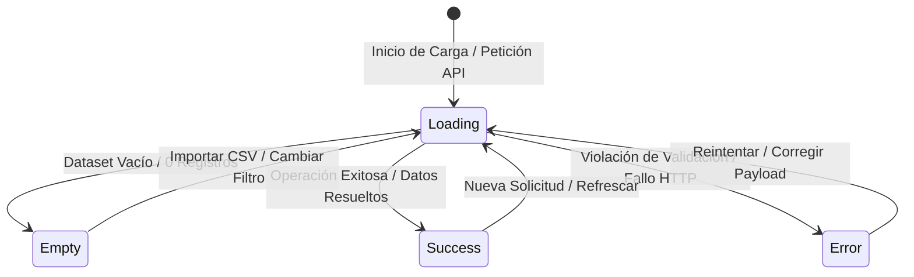

# EXPERIENCE.md — Especificación de Experiencia y Estados de UI
## Módulo 1: User, Role, and Subject Access Manager (Tier: Foundation)

---

## 1. Principios de Experiencia e Interacción

En el diseño de gobernanza para la plataforma de cómputo IA, **el contenido es estrategia y la psicología del usuario guía cada decisión visual**:
1. **Gobierno Transparente sin Fricción:** Los administradores académicos como el *Dr. Marcus Vance* necesitan certezas inmediatas; una operación masiva de 120 alumnos no puede dejar dudas sobre qué identidades fueron creadas, cuáles existían y cuáles entraron en cuarentena.
2. **Cero Suposiciones sobre Accesos Denegados (Explicabilidad Radical):** Si a *Mateo* se le bloquea una solicitud, o si a *Sofia* se le rechaza un modelo docente, la interfaz nunca mostrará un genérico "Acceso Denegado". Cada decisión algorítmica viene acompañada de una justificación estructurada, citando la regla académica y el contexto de asignatura activo.
3. **Seguridad Defensiva con Feedback Humano:** Todo intento de escalación no autorizado o error de integridad transaccional se traduce en mensajes constructivos y no repiantes, cerrando la puerta a la confusión operativa.

---

## 2. Máquinas de Estado de la Interfaz de Usuario



### 2.1 Estado de Carga (Loading State)
- **Comportamiento en Tablas de Administración:**
  - Se despliegan *Skeleton Screens* animados con pulsación suave (CSS `cubic-bezier(0.4, 0, 0.6, 1)`) sobre las filas de la tabla de identidades y membresías, preservando el ancho de columnas para evitar saltos de diseño (*Cumulative Layout Shift = 0*).
- **Comportamiento en Ingestión Masiva de Nómina:**
  - La carga de 120 estudiantes en *CS-480* muestra una barra de progreso determinista de **subida** calculada en el cliente (bytes enviados / bytes totales): `Subiendo nómina: 65% (3,2 MB / 4,9 MB)...`. Al completar la subida, el botón de acción cambia a estado inactivo con micro-spinner giratorio integrado (`Validando lote atómico...`) hasta la respuesta 201 o 422. [ACTUALIZADO 2026-10-14, Solu-2 K-4/R10-M1: la ingesta es atómica y síncrona (AD-02), no hay progreso por fila en backend]
  - El botón de acción cambia a estado inactivo con micro-spinner giratorio integrado (`Validando lote atómico...`) y se deshabilita la navegación circundante para prevenir envíos duplicados.
- **Comportamiento en RBAC API Explorer:**
  - Al presionar `[Send Request]`, el panel de respuesta muestra un overlay translúcido con indicador de latencia en vivo: `Evaluando tupla (subject, role, resource, action)...`.

### 2.2 Estado Vacío (Empty State)
Diseñado para orientar a los protagonistas y eliminar la sensación de pantalla rota cuando no hay datos disponibles:

#### Caso A: Asignatura sin Estudiantes Matriculados (Inicio de Semestre)
- **Superficie:** Pestaña de Membresías en Web Admin Portal.
- **Gráfico:** Ilustración vectorial minimalista en tonos pizarra de un cuaderno de notas vacío.
- **Título:** *"Aún no hay estudiantes vinculados a CS-480"*
- **Descripción:** *"Esta asignatura no cuenta con inscripciones activas para el período 2026-FALL. El Dr. Marcus Vance puede importar la nómina oficial mediante archivo CSV o sincronizar los fixtures institucionales."*
- **Botones de Acción Primaria (CTA):**
  - Botón primario: `[ 📥 Cargar Nómina CSV (120 alumnos) ]`
  - Botón secundario: `[ ⚡ Cargar Fixture Demo CS-480 ]`

#### Caso B: Cero Solicitudes de Escalación Pendientes
- **Superficie:** Bandeja de Aprobación de Escalaciones del Dr. Marcus Vance.
- **Gráfico:** Badge verde esmeralda con check redondeado.
- **Título:** *"Bandeja de escalaciones al día"*
- **Descripción:** *"No existen solicitudes de privilegios temporales pendientes de revisión para ninguna de las materias activas."*

#### Caso C: Búsqueda de Auditoría sin Coincidencias
- **Superficie:** Visor Forense de la Dra. Elena Gómez.
- **Título:** *"No se encontraron eventos de acceso para los criterios seleccionados"*
- **Descripción:** *"No se registraron denegaciones ni accesos sobre la clase 'model:restricted:research' en la ventana de los últimos 30 días."*
- **Acción:** `[ ↺ Restablecer filtros de búsqueda ]`

#### Caso D: Identidad Académica sin Asignaturas Vinculadas (`EDGE-UX-01`)
- **Superficie:** Selector de Contexto y Portal Principal para cuentas recién creadas.
- **Gráfico:** Tarjeta con borde punteado pizarra y silueta de carné universitario.
- **Título:** *"No tienes asignaturas activas vinculadas para este período"*
- **Descripción:** *"Tu cuenta institucional está activa en la plataforma, pero aún no has sido asignado a ninguna nómina académica del semestre 2026-FALL. El selector de contexto permanecerá deshabilitado temporalmente."*
- **Acciones:**
  - Botón primario: `[ 🔍 Consultar Estado en Registro Central ]`
  - Botón secundario: `[ ✉ Notificar al Dr. Marcus Vance (Admin) ]`

### 2.3 Estado de Error (Error State)
Todo error se comunica con estructura RFC-7807 y elementos visuales claros:

#### Caso A: Violación de Integridad en Nómina (Correo Inválido en Fila 85)
- **Modal de Error Transaccional:**
  - Borde superior en rojo carmesí (`--status-blocked-border`).
  - **Encabezado:** `Error de Validación: Transacción Atómica Abortada (HTTP 422)`
  - **Mensaje Principal:** *"El lote de 120 registros para CS-480 fue rechazado en su totalidad. Ningún registro fue insertado en la base de datos para preservar la consistencia académica."*
  - **Detalle de Error Identificado:**
    - Fila afectada: `Línea 85`
    - Identidad: `STU-98432 (Mateo Silva)`
    - Campo con fallo: `email: "mateo.personal@gmail.com"`
    - Regla violada: `EMAIL_DOMAIN_MUST_BE_INSTITUTIONAL (@universidad.edu)`
  - **Acciones:** `[ Descargar Manifiesto de Corrección ]` y `[ Reintentar Carga ]`.

#### Caso B: Intento No Autorizado de Auto-Aprobación de Escalación
- **Banner de Seguridad Crítica en RBAC API Explorer:**
  - Fondo `--status-blocked-bg`, Borde `--status-blocked-border`.
  - Icono de escudo de seguridad con advertencia.
  - **Texto:** `HTTP 403 Forbidden: Intento de Auto-Aprobación No Autorizado`
  - **Detalle:** *"La identidad TA-SOFIA-01 no posee facultades administrativas para autorizar la solicitud ESC-2026-480-01. La aprobación requiere estrictamente la firma digital del Dr. Marcus Vance (CS Department Chair). Se ha registrado un evento inmutable de alerta en el ledger de auditoría."*

### 2.4 Estado de Éxito (Success State)
- **Ingestión Masiva Exitosa:**
  - Banner verde esmeralda con resumen cuantitativo en chips:
    `✔ Nómina CS-480 procesada con éxito: [120 Procesados] [115 Creados] [5 Vinculados] [0 Errores]`
  - Botón adyacente: `[ Ver 120 Credenciales Aprovisionadas ]`.
- **Escalación Temporal Concedida:**
  - Badge pulsante ámbar con temporizador regresivo dinámico en la barra superior:
    `⚡ Rol Activo: Instructor-Privileged (CS-480) · Expira en: 03h : 59m : 42s · [Revocar Ahora]`

### 2.5 Recuperación de Sesión In-Situ en Consultas Forenses Masivas (`EDGE-UX-03`)
- **Superficie:** Visor de Auditoría Forense y Exportador CSV/JSON.
- **Disparador:** El token Bearer JWT de la Dra. Elena Gómez o del Dr. Marcus Vance expira tras 15 minutos de inactividad durante una sesión de inspección profunda.
- **Mecanismo de Preservación de Estado:**
  - La llamada AJAX para paginación o descarga recibe `HTTP 401 Unauthorized`.
  - Se despliega de inmediato un modal superpuesto (*Focus Trap*) sin recargar la página:
    ```
    +-------------------------------------------------------------------------+
    |  [🔒] SESIÓN EXPIRADA POR POLÍTICA DE SEGURIDAD                         |
    |                                                                         |
    |  Su token de acceso ha expirado tras 15 minutos de inactividad.         |
    |  Para proteger los datos forenses, ingrese sus credenciales para         |
    |  reanudar la consulta sin perder los filtros ni la paginación activa.   |
    |                                                                         |
    |  [ Contraseña o Token Institucional: **************** ]                 |
    |  [ ✔ Reanudar Sesión Forense ]   [ Cancelar y Salir ]                   |
    +-------------------------------------------------------------------------+
    ```
  - Al re-autenticar, el cliente reintenta automáticamente la petición fallida en background, preservando intactos el rango de 30 días, la página activa y el cursor de datos.

---

## 3. Banners Obligatorios de Explicabilidad Algorítmica

En una plataforma de cómputo compartida con recursos finitos (workstations de 24 GB y servidor de 96 GB), **las decisiones automatizadas de denegación o degradación de permisos deben ser 100% comprensibles para el estudiante y el docente**, evitando conflictos y reduciendo tickets de soporte innecesarios.

### 3.1 Anatomía Estándar del Banner de Explicabilidad

```
+--------------------------------------------------------------------------------------------------+
| [!] DECISIÓN: ACCESO DENEGADO (HTTP 403)               Contexto Activo: CS101 Intro to Prog     |
+--------------------------------------------------------------------------------------------------+
| Causa Algorítmica: El recurso solicitado pertenece a un nivel de cómputo restringido para el     |
| rol actual del solicitante dentro de la asignatura especificada.                                 |
|                                                                                                  |
| • Identidad del Solicitante: Mateo Silva (STU-98432)                                            |
| • Rol Efectivo en Contexto: Student (CS101)                                                      |
| • Recurso Solicitado: urn:uai:subject:cs-480:model:llama-3-8b-instruct                           |
| • Regla Inviolable Violada: AD-01 (Context Isolation & Resource-Subject Binding)                 |
|                                                                                                  |
| Explicación Técnica: Mateo posee derechos para este modelo bajo la materia CS-480, pero la      |
| petición actual se emitió bajo el contexto de CS101 (donde no existe cuota de GPU aprobada).    |
|                                                                                                  |
| Solución Recomendada: Modifique el encabezado de su cliente a:                                   |
| 'X-Academic-Subject-Context: CS-480' para utilizar su perfil y permisos de dicha asignatura.    |
+--------------------------------------------------------------------------------------------------+
```

### 3.2 Catálogo de Banners de Explicabilidad por Escenario Crítico

#### Banner E-01: Confused Deputy / Invocación Cruzada de Recursos
- **Disparador:** Sofia intenta invocar un modelo de investigación de *NLP Advanced* declarando en su petición el contexto de *CS-480* (donde tiene rol TA).
- **Semántica Visual:** Borde y texto en rojo carmesí (`--status-blocked-border`).
- **Título del Banner:** `Conflicto de Asignatura: Recurso no Perteneciente al Contexto Declarado`
- **Código Algorítmico:** `RESOURCE_SUBJECT_MISMATCH (HTTP 403)`
- **Texto Explicativo:**
  *"El modelo `urn:uai:subject:nlp-advanced:model:llama-3-70b-research` pertenece a la asignatura NLP Advanced. Su sesión activa declara el contexto `CS-480 (Intro to ML)`. Aunque Sofia posee facultades elevadas en CS-480, las prerrogativas docentes de una materia no pueden transferirse para acceder a recursos de otra cátedra (Principio de Aislamiento de Materia)."*
- **Acción Sugerida:** *"Cambie su contexto a NLP Advanced en el encabezado de su solicitud o solicite al Dr. Marcus Vance la asignación de permisos directos en dicho curso."*

#### Banner E-02: Revocación Inmediata por Cancelación de Materia (*Course Drop*)
- **Disparador:** Mateo intenta invocar un modelo privado de *CS-480* tras haber cancelado la materia.
- **Semántica Visual:** Borde rojo carmesí con icono de candado cerrado.
- **Título del Banner:** `Matrícula Cancelada: Acceso a Pool Privado Revocado`
- **Código Algorítmico:** `SUBJECT_ENROLLMENT_DROPPED (HTTP 403)`
- **Texto Explicativo:**
  *"El sistema de registro académico notificó la baja formal de Mateo Silva en CS-480 el 2026-09-23T15:04:05Z. Sus credenciales para esta materia fueron invalidadas en el motor de autorización en un tiempo de 184 ms. Sus accesos para otras materias vigentes (como CS101) permanecen inalterados."*
- **Acción Sugerida:** *"Si considera que se trata de un error administrativo, consulte con la oficina de registro o con el Dr. Marcus Vance."*

#### Banner E-03: Expiración de Escalación Temporal de Privilegios
- **Disparador:** Sofia intenta ejecutar un script de entrenamiento intensivo cuando han transcurrido más de 4 horas desde la aprobación.
- **Semántica Visual:** Borde ámbar ocre (`--status-pending-border`).
- **Título del Banner:** `Ventana de Escalación Expirada: Rol Restablecido a Base`
- **Código Algorítmico:** `STATUS_ESCALATION_EXPIRED (HTTP 403)`
- **Texto Explicativo:**
  *"La ventana temporal de 4 horas concedida por el Dr. Marcus Vance para la escalación `ESC-2026-480-01` (Instructor-Privileged) finalizó a las 18:30:00Z. El rol de Sofia para CS-480 ha sido retornado automáticamente a 'Teaching Assistant'."*
- **Acción Sugerida:** *"Si requiere tiempo adicional para pruebas docentes, envíe una nueva solicitud formal indicando la duración y justificación requerida."*

#### Banner E-04: Solicitud de Escalación Denegada por Jefatura (`EDGE-UX-02`)
- **Disparador:** El Dr. Marcus Vance rechaza formalmente la solicitud de escalación de Sofia mediante el botón `[ ✖ Denegar con Motivo ]`.
- **Semántica Visual:** Borde y acento rojo carmesí (`--status-blocked-border`), icono de documento cancelado.
- **Título del Banner:** `Solicitud de Escalación Temporal Denegada por Jefatura`
- **Código Algorítmico:** `ESCALATION_REQUEST_REJECTED (HTTP 403)`
- **Texto Explicativo:**
  *"Su solicitud `ESC-2026-480-01` para asumir el rol temporal Instructor-Privileged en CS-480 fue DENEGADA por el Dr. Marcus Vance el 2026-09-23T16:15:00Z.*  
  **Justificación de Jefatura:** 'La flota de 31 workstations estará reservada de forma exclusiva para el examen práctico de CS101 entre las 14:00 y las 18:00 hrs.'*  
  *El rol de Sofia permanece como Teaching Assistant regular sin alteraciones."*
- **Acción Sugerida:** *"Podrá presentar una nueva solicitud para ventanas horarias posteriores a las 18:00 hrs. El formulario para este horario permanecerá en enfriamiento durante 30 minutos."*

---

## 4. Estándar de Accesibilidad WCAG 2.1 Nivel AA

El prototipo del Módulo 1 está diseñado para ser plenamente operable por personas con discapacidad visual, motriz o cognitiva en cumplimiento del estándar internacional **WCAG 2.1 AA**:

### 4.1 Ratios de Contraste Cromático Verificados
- **Texto Estándar sobre Fondo Base:** `--text-primary` (`#f9fafb`) sobre `--bg-canvas` (`#090d16`) proporciona un ratio de contraste de **14.8:1** (superando holgadamente el requisito de 4.5:1).
- **Texto Secundario y Metadatos:** `--text-secondary` (`#9ca3af`) sobre `--bg-surface-elevated` (`#111827`) proporciona un ratio de **6.4:1** (requisito: $\ge 4.5:1$).
- **Badges de Estado:** Ningún estado depende exclusivamente del color; cada badge combina color de fondo, borde contrastado, icono representativo y texto explicativo en mayúsculas (`[✔ ACTIVE]`, `[⚡ PENDING]`, `[✖ REVOKED]`, `[👁 READ-ONLY]`).

### 4.2 Navegación Completa por Teclado y Gestión del Foco
- **Secuencia Lógica de Tabulación (Tab Order):** La navegación sigue un orden predecible: Barra de navegación superior $\rightarrow$ Selector de contexto de materia $\rightarrow$ Pestañas principales $\rightarrow$ Filtros de tabla $\rightarrow$ Celdas y acciones $\rightarrow$ Consola del API Explorer.
- **Anillo de Enfoque Visible (Focus Visible Ring):** Todo elemento interactivo al recibir foco por teclado muestra un contorno visible continuo de $2\,\text{px}$ en color azul `--brand-primary` (`#3b82f6`) con un desplazamiento exterior (*offset*) de $2\,\text{px}$, claramente diferenciable del fondo oscuro.
- **Trampa de Foco en Modales (Focus Trap):** Al abrir el modal de aprobación de escalación o el visor de errores de CSV, el foco queda confinado dentro del modal; la tecla `Escape` cierra el diálogo y devuelve el foco al elemento disparador.
- **Enlace de Salto (Skip Link):** Se incluye un enlace oculto `[Saltar al contenido principal]` accesible como primer elemento tabulable para usuarios de lectores de pantalla.

### 4.3 Semántica ARIA y Soporte para Lectores de Pantalla
- **Regiones Vivas (ARIA Live Regions):**
  - El visualizador de logs del RBAC API Explorer utiliza `aria-live="polite"` para anunciar la llegada de nuevas respuestas sin interrumpir la lectura del usuario.
  - Los banners de error de seguridad e intentos no autorizados utilizan `role="alert"` y `aria-live="assertive"` para notificar de inmediato cualquier fallo crítico.
- **Etiquetado de Formularios y Estados:**
  - Todos los inputs del generador de peticiones cuentan con `aria-label` o `aria-labelledby`.
  - Los desplegables de selección de materia cuentan con atributos `aria-haspopup="listbox"` y `aria-expanded="false|true"`.
  - Las tablas de membresías implementan encabezados accesibles con `scope="col"` y marcas de ordenamiento `aria-sort="ascending|descending"`.
