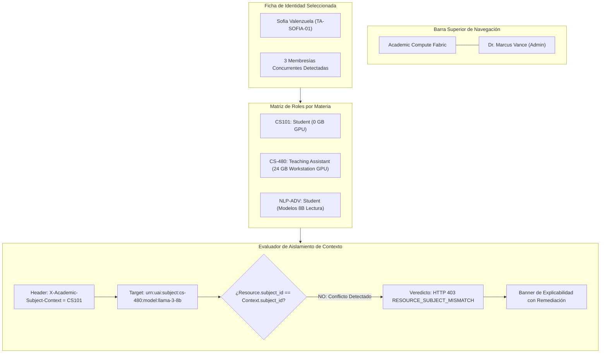

# Wireframe A: Consola de Administración de Roles y Resolución de Conflictos

**Módulo:** Módulo 1 — User, Role, and Subject Access Manager  
**Superficie:** Web Admin Portal + RBAC Multi-Subject Inspector  
**Protagonistas:** Dr. Marcus Vance (Admin) & Sofia (TA / Estudiante)  
**Caso de Borde Demostrado:** Membresía Concurrente de Sofia en CS101 (Student, 0 GPU) vs CS-480 (Teaching Assistant, Alta Prioridad)  

---

## 1. Mockup ASCII de Alta Fidelidad

```
+===================================================================================================================================+
|  ACADEMIC AI COMPUTE FABRIC  |  Módulo 1: User, Role & Subject Access Manager           [Sesión: Dr. Marcus Vance (CS Chair & Admin)]|
+===================================================================================================================================+
|  [📚 Asignaturas]   [👥 Identidades]   [⚡ Escalaciones (1 Pendiente)]   [🔒 Auditoría Forense]   [⚙ Configuración RBAC]            |
+-----------------------------------------------------------------------------------------------------------------------------------+
|  INSPECTOR DE CONTEXTO Y CONFLICTOS ACADÉMICOS                                                                                    |
|  Identidad Seleccionada: Sofia Valenzuela [TA-SOFIA-01]  ·  Email: sofia.valenzuela@universidad.edu  ·  Estado: [✔ MATRÍCULA ACTIVA]     |
+-----------------------------------------------------------------------------------------------------------------------------------+
|                                                                                                                                   |
|  +- MEMBRESÍAS ACTIVAS Y MATRIZ DE PERMISOS EN CONFLICTO ------------------------------------------------------------------------+ |
|  | Cód. Materia | Nombre de la Asignatura         | Rol Asignado       | Nivel de GPU       | Privilegios Especiales | Estado     | |
|  |--------------|---------------------------------|--------------------|--------------------|------------------------|------------| |
|  | CS101        | Intro to Computer Science       | [ Student ]        | 0 GB (Solo CPU)    | Ninguno                | [ ACTIVE ] | |
|  | CS-480       | Intro to Machine Learning       | [ Teaching Assist] | 24 GB Workstations | Solicitud Escalación   | [ ACTIVE ] | |
|  | NLP-ADV      | Advanced Natural Lang Process   | [ Student ]        | 24 GB (Bajo Dem.)  | Modelos 8B Lectura     | [ ACTIVE ] | |
|  +--------------------------------------------------------------------------------------------------------------------------------+ |
|                                                                                                                                   |
|  +- SIMULADOR DE RESOLUCIÓN EN TIEMPO REAL (Context-Enforced RBAC Evaluator) ----------------------------------------------------+ |
|  |                                                                                                                                |
|  |  Paso 1: Seleccione el Contexto Académico Declarado por el Cliente:                                                           |
|  |  [ X-Academic-Subject-Context: CS101 (Intro to CS) ▼ ]                                                                         |
|  |                                                                                                                                |
|  |  Paso 2: Recurso Solicitado para Evaluación:                                                                                   |
|  |  Target Resource ARN: [ urn:uai:subject:cs-480:model:llama-3-8b-instruct                                  ]                    |
|  |  Acción Solicitada:   [ model:invoke                                                                      ]                    |
|  |                                                                                                                                |
|  |  [ ⚡ EVALUAR POLÍTICA DE AUTORIZACIÓN ]   [ Generar cURL ]   [ Probar con Contexto CS-480 ]                                    |
|  |                                                                                                                                |
|  |  +-- BANNER DE EXPLICABILIDAD ALGORÍTMICA (Resultado en 14ms): -------------------------------------------------------------+ |
|  |  |  [✖] DECISIÓN: DENEGADO (HTTP 403 FORBIDDEN) · CÓDIGO: RESOURCE_SUBJECT_MISMATCH                                        | |
|  |  |                                                                                                                          | |
|  |  |  DIAGNÓSTICO AUTOMATIZADO:                                                                                               | |
|  |  |  Sofia intentó invocar un recurso perteneciente a "CS-480", pero su petición declaró el contexto académico "CS101".      | |
|  |  |  En CS101, Sofia posee rol 'Student' con política estricta de CERO ACCESO A GPU.                                         | |
|  |  |                                                                                                                          | |
|  |  |  REGLA INVIOLABLE APLICADA:                                                                                              | |
|  |  |  Invariant AD-01 (Context Isolation & Confused Deputy Prevention): Los privilegios elevados de Teaching Assistant en      | |
|  |  |  CS-480 NO se heredan ni transfieren a peticiones cursadas bajo el contexto de CS101 o NLP-ADV.                           | |
|  |  |                                                                                                                          | |
|  |  |  ACCIÓN RECOMENDADA PARA SOFIA:                                                                                          | |
|  |  |  Cambie su encabezado HTTP en su cliente a: 'X-Academic-Subject-Context: CS-480' para operar bajo sus credenciales de TA.| |
|  |  +--------------------------------------------------------------------------------------------------------------------------+ |
|  +--------------------------------------------------------------------------------------------------------------------------------+ |
+===================================================================================================================================+
```

---

## 2. Diagrama de Interacción en Mermaid UI


