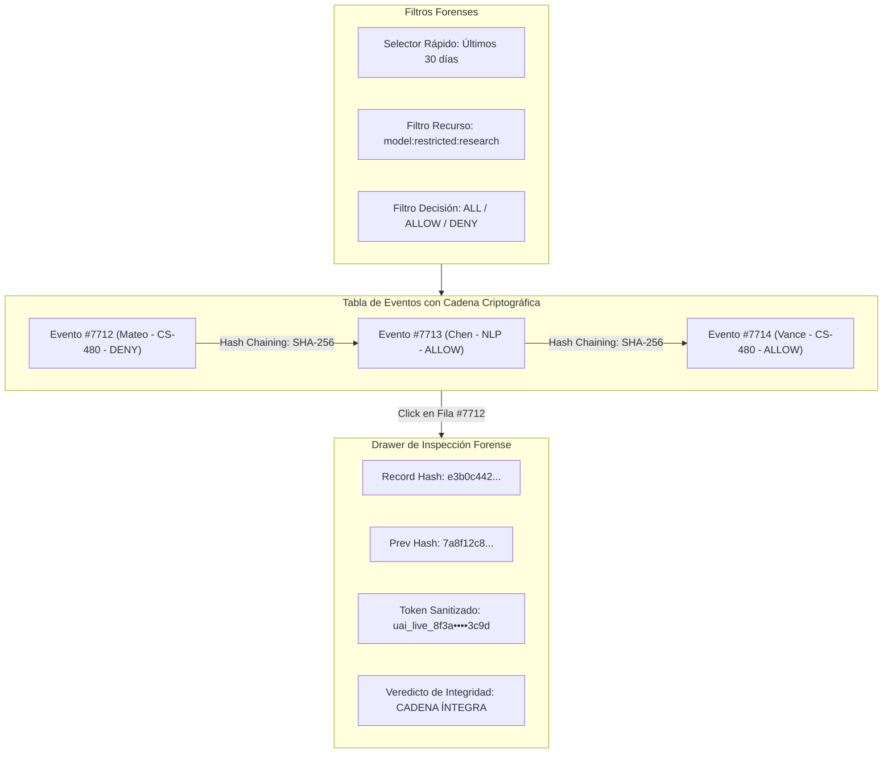

# Wireframe B: Visor de Auditoría Forense y Trazabilidad Criptográfica

**Módulo:** Módulo 1 — User, Role, and Subject Access Manager  
**Superficie:** Compliance & Forensic Audit Ledger  
**Protagonistas:** Dra. Elena Gómez (Auditora) & Dr. Marcus Vance (Admin)  
**Escenario Soportado:** Escenario 4 (`FR-AUDIT-04`) — Inspección Forense de Modelos Restringidos de Investigación  

---

## 1. Mockup ASCII de Alta Fidelidad

```
+===================================================================================================================================+
|  ACADEMIC AI COMPUTE FABRIC  |  Módulo 1: User, Role & Subject Access Manager        [Sesión: Dra. Elena Gómez (Compliance Lead)] |
+===================================================================================================================================+
|  [📚 Asignaturas]   [👥 Identidades]   [⚡ Escalaciones]   [🔒 Auditoría Forense (Activo)]   [⚙ Configuración RBAC]                 |
+-----------------------------------------------------------------------------------------------------------------------------------+
|  REGISTRO INMUTABLE DE AUDITORÍA Y NO REPUDIO (Hash-Chained Access Ledger)                                                        |
+-----------------------------------------------------------------------------------------------------------------------------------+
|                                                                                                                                   |
|  +- BARRA DE FILTROS FORENSES ---------------------------------------------------------------------------------------------------+ |
|  |  Rango Temporal:  [ 7 Días ]  [ 15 Días ]  [ ● Últimos 30 Días ]  [ Rango Custom ]                                            | |
|  |  Tipo de Recurso: [ model:restricted:research (Modelos de Investigación) ▼ ]                                                  | |
|  |  Decisión:        [ Todos (142) ]  [ ✔ ALLOW (38) ]  [ ✖ DENY (104) ]                                                         | |
|  |  Paginación:      [ 50 por página ▼ ]  ·  Mostrando 1–50 de 142 eventos  (Latencia de Búsqueda: 168 ms)                        | |
|  |  [ 🔍 Aplicar Filtros ]   [ 📥 Exportar CSV Certificado ]   [ 🛡 Verificar Cadena Hash Completa ]                              | |
|  +-------------------------------------------------------------------------------------------------------------------------------+ |
|                                                                                                                                   |
|  +- ESTADO DE INTEGRIDAD CRIPTOGRÁFICA ------------------------------------------------------------------------------------------+ |
|  |  [✔ SHA-256 CADENA ÍNTEGRA] 142 de 142 registros consecutivos validados matemáticamente. Cero alteraciones detectadas.        | |
|  +-------------------------------------------------------------------------------------------------------------------------------+ |
|                                                                                                                                   |
|  +- TABLA DE EVENTOS FORENSES ----------------------------------------------------------------------+-- DETALLE CRIPTOGRÁFICO ---+ |
|  | ID Evento    | Timestamp (UTC)       | Actor / Sujeto     | Materia | Decisión | Hash Status     | | Evento: evt-7712-bc9       | |
|  |--------------|-----------------------|--------------------|---------|----------|-----------------| | Timestamp:                 | |
|  | evt-7715-aa1 | 2026-09-23 14:10:02Z  | TA-SOFIA-01        | CS-480  | [ALLOW]  | [🔗 SHA-256 OK] | | 2026-09-12 10:14:22 UTC    | |
|  | evt-7714-f02 | 2026-09-21 09:30:15Z  | DR-VANCE-00        | CS-480  | [ALLOW]  | [🔗 SHA-256 OK] | | Actor: Mateo Silva         | |
|  | evt-7713-91c | 2026-09-18 16:45:00Z  | RES-CHEN-04        | NLP-ADV | [ALLOW]  | [🔗 SHA-256 OK] | | ID: STU-98432 (Student)    | |
|  |>evt-7712-bc9 | 2026-09-12 10:14:22Z  | STU-98432 (Mateo)  | CS-480  | [DENY]   | [🔗 SHA-256 OK] | | Recurso Solicitado:        | |
|  | evt-7711-48b | 2026-09-10 11:05:40Z  | STU-55210 (Laura)  | CS101   | [DENY]   | [🔗 SHA-256 OK] | | ...:biomed-llm-70b         | |
|  | evt-7710-12e | 2026-09-08 08:20:19Z  | TA-SOFIA-01        | CS-480  | [ALLOW]  | [🔗 SHA-256 OK] | | Decisión:                  | |
|  | evt-7709-bb4 | 2026-09-05 18:02:11Z  | STU-98432 (Mateo)  | CS-480  | [DENY]   | [🔗 SHA-256 OK] | | [✖ DENY: UNAUTHORIZED_ROLE]| |
|  +--------------------------------------------------------------------------------------------------+ |                              | |
|                                                                                                       | Token Enmascarado (NFR-04):  | |
|                                                                                                       | uai_live_8f3a•••••••••••3c9d | |
|                                                                                                       |                              | |
|                                                                                                       | Prev Record Hash:            | |
|                                                                                                       | 7a8f12c8b01934ac...          | |
|                                                                                                       | Current Record Hash:         | |
|                                                                                                       | e3b0c44298fc1c149afbf4...    | |
|                                                                                                       | [✔ Firma Hash Verificada]    | |
+===================================================================================================================================+
```

---

## 2. Diagrama de Flujo y Componentes en Mermaid UI


